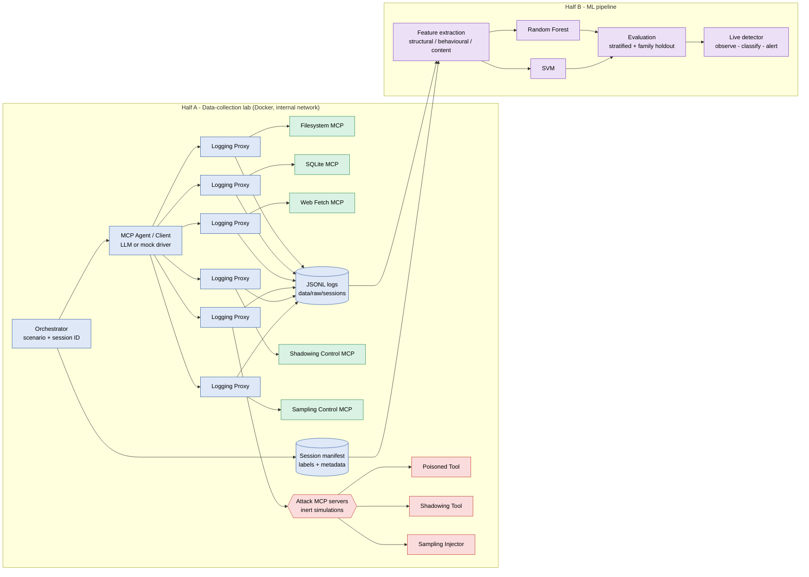
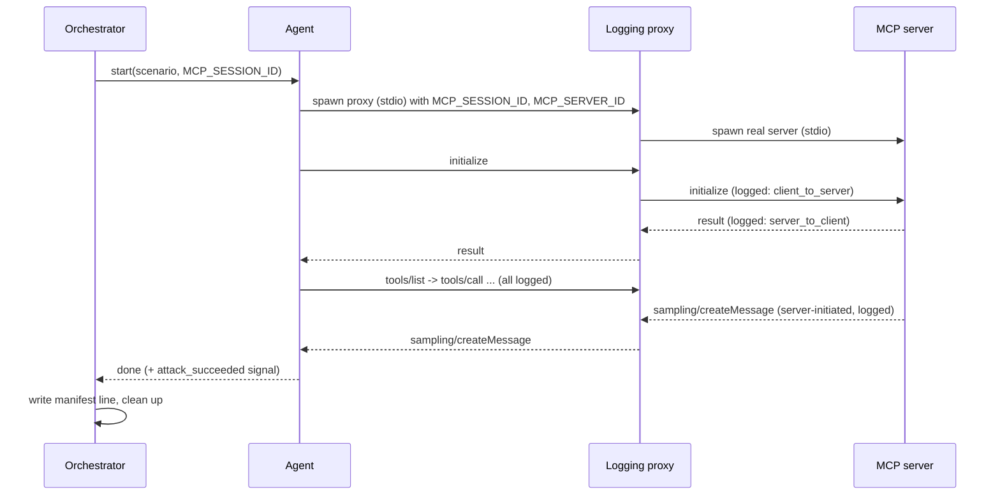

# Architecture

## 1. The big picture (simple version)

The project has two halves:

* **Half A — the data-collection lab** *produces* MCP traffic. An orchestrator
  runs a scenario; an agent talks to MCP servers; logging proxies sit in the
  middle and write down every message.
* **Half B — the ML pipeline** *consumes* that traffic. It turns each session
  into a row of numbers (features), trains classifiers, measures how well they
  detect attack attempts, and later classifies live traffic.



A presentation-quality version is in
[docs/images/architecture.svg](docs/images/architecture.svg).

## 2. Components

| Component | Folder | Phase | Responsibility |
|---|---|---|---|
| Server registry | `common/registry.py` | 1 ✅ | Single source of truth for how to launch each MCP server |
| Filesystem MCP | `servers/benign/filesystem/` | 1 ✅ | list/read/write/search, confined to `sandbox/` |
| Basic client | `agent/client.py` | 1 ✅ | stdio connect, `initialize`, `tools/list`, scripted `tools/call` |
| Agent driver | `agent/driver.py`, `llm.py`, `tasks.py` | 2 ✅ | Multi-server tool loop; mock (seeded) or Claude brain; `AgentRun` record |
| Session sandbox | `common/sandbox.py` | 2 ✅ | Fresh temp copy of `sandbox/` per session; seed never modified |
| Logging proxy | `proxy/` | 3 ✅ | Transparent stdio relay; logs every JSON-RPC message as JSONL; `proxy.reader` rebuilds sessions |
| SQLite / Web Fetch MCP | `servers/benign/` | 4 ✅ | Seeded dummy DB (authorizer-enforced read-only queries); fetch limited to the `testweb` site |
| Lab environment | `common/lab_env.py` | 4 ✅ | Per-session sandbox copy, fresh DB, test-site URL |
| Orchestrator | `orchestrator/` | 5 ✅ | Scenarios, session runner (parallel), validated manifest, `verify` cross-check |
| Attack simulations | `servers/attack/` | 6–8 ✅ | Poisoned-tool metadata twin, cross-server shadowing metadata twin, and bounded sampling-request twin; all inert |
| Dataset generation | `scripts/generate_phase9.py` | 9 ✅ | Balanced matched benign/attack sessions, reproducible mock seeds, JSONL/manifest quality checks, immutable new output directory |
| Simulation constants | `common/simulation.py` | 6 ✅ | Marker, canaries, `neutralize()` for feature extraction |
| Features | `features/` | 10 ✅ | Session → 62 features (structural / behavioural / content); `neutralize()` applied in memory |
| ML | `ml/` | 11–13 ✅ | Leakage-guarded loading, RF/SVM pipelines, stratified split, evaluation, inference (`Detector`) |
| Detector | `detector/` | 14 ✅ | Observe-only **sidecar** that reads the proxies' logs, classifies running and finished sessions, writes JSONL alerts ([docs/detector.md](docs/detector.md)) |

## 3. Message flow for one session



## 4. Key design decisions (and why)

1. **stdio transport only (for now).** It is the most common way MCP servers
   are run locally, needs no ports, and gives a clean "pipe" for the proxy to
   sit on. Streamable HTTP is future work.

2. **One proxy per server, shared session ID.** stdio has no session concept,
   so the orchestrator generates a UUID and passes it as `MCP_SESSION_ID` to
   every proxy (and server). All JSONL lines from all servers in one experiment
   can then be joined back into one session. Phase 1 already passes this
   variable from the client.

3. **Why one lab container instead of one container per MCP server.** A stdio
   MCP server must be a *child process* of whoever talks to it. Putting each
   server in its own container would require the agent container to control
   Docker (mounting the Docker socket), which effectively grants root on the
   host — a far bigger risk than the one we are trying to contain. So:
   * the agent, proxies and all stdio servers run as processes inside one
     unprivileged `lab` container on an **internal-only** network;
   * services that genuinely are network services get their own container
     on the same internal network. Since Phase 4 that is `testweb`, the
     synthetic website for the web-fetch server (read-only container, no
     published ports).
   Moving to per-server containers becomes natural when we add Streamable HTTP.

4. **The proxy forwards bytes unchanged.** It parses a *copy* of each line for
   logging. Detection must never alter the traffic it measures (and the live
   detector is observe-only). Each proxy writes its own file
   (`<session_id>/<server_id>.jsonl`), because concurrent appends from
   several processes to one file are not safe on Windows. Files are merged by
   `ts_ns`. Details: [docs/proxy.md](docs/proxy.md).

5. **Attack attempt ≠ attack success.** Every attack session records
   `attack_attempted` and `attack_succeeded`. The IDS target label is the
   **attempt** — malicious metadata is present on the wire whether or not this
   particular LLM fell for it. Success is recorded for analysis only.

6. **Raw data is immutable.** `data/raw/` is written only by the proxy; feature
   engineering reads it and writes to `data/processed/`.

7. **Two evaluation splits.** A stratified random split (baseline) *and* an
   attack-family holdout split (train on some families, test on an unseen
   one). The second answers "does it generalise to new attacks?", which a
   random split cannot.

8. **Structure and behaviour first, content second.** Keyword rules ("contains
   *ignore previous instructions*") are allowed as *features*, never as the
   detector. The research contribution is whether traffic *shape* (message
   counts/sizes, method sequences, direction ratios, cross-server patterns,
   server-initiated requests) separates attacks from benign sessions.

9. **Mock LLM by default, Claude optional.** The bulk dataset is generated by a
   seeded mock brain (reproducible, free, offline). Claude is used where a real
   model's reaction matters (`attack_succeeded`). Both produce the same MCP
   wire protocol; only the choice of calls differs. See [docs/agent.md](docs/agent.md).

10. **Tool namespacing `<server>__<tool>`.** This is our client's policy, not
    part of MCP. Call records keep the original server and tool name, so
    features never depend on it.

11. **Fresh sandbox per session.** Writes in session N must not leak into
    session N+1, otherwise the dataset would depend on generation order.

12. **Real-LLM runs happen on the host, not in the lab container.** The lab
    network has no internet route by design. Weakening that just to reach
    the API is not worth it at this stage; revisit with an explicit
    egress-only proxy if needed.

## 5. Planned data layout

```
data/
├── raw/sessions/<session_id>/<server_id>.jsonl   # one JSON-RPC message per line, one file per proxy
├── manifests/sessions.jsonl          # one line per session: labels + metadata
├── processed/                        # features.csv, sessions.parquet (derived)
└── models/                           # trained models + feature schema + metadata
experiments/exp_NNN/{config.json, metrics.json, notes.md}
```

Proxy log line (Phase 3, full schema in [docs/dataset.md](docs/dataset.md)):

```json
{"session_id": "8fbd…", "timestamp": "2026-10-03T00:50:34.867Z",
 "direction": "client_to_server", "server_id": "filesystem",
 "method": "tools/call", "jsonrpc_id": 3, "kind": "request",
 "message_size": 112, "is_error": false, "body": {"jsonrpc": "2.0", "...": "..."}}
```

Manifest line (Phase 5, full schema in [docs/dataset.md](docs/dataset.md)):

```json
{"session_id": "8fbd…", "scenario_id": "scenario_001", "label": "benign",
 "attack_family": null, "attack_attempted": false, "attack_succeeded": false,
 "servers": ["filesystem", "sqlite"]}
```

## 6. Implementation notes

* **MCP SDK version:** `mcp==2.2.0`. In 2.x, `FastMCP` was renamed
  `mcp.server.mcpserver.MCPServer`; client code uses `stdio_client` +
  `ClientSession` as before. Tool failures are raised as `ToolError` and reach
  the client as a normal result with `isError: true` — useful error telemetry.
* **Filesystem sandbox:** every client path is resolved with
  `Path.resolve()` (collapses `..`, follows symlinks) and must satisfy
  `is_relative_to(sandbox_root)`. Size limits bound reads (256 KiB) and writes
  (64 KiB).
* **stdout discipline:** stdio servers must never `print` — stdout *is* the
  protocol channel. All diagnostics go to stderr.
* **Anthropic SDK:** `anthropic==1.11.0` (built on `httpx2`). Claude is
  called through `client.beta.messages.create` because the refusal-fallback
  parameter is a beta feature.
