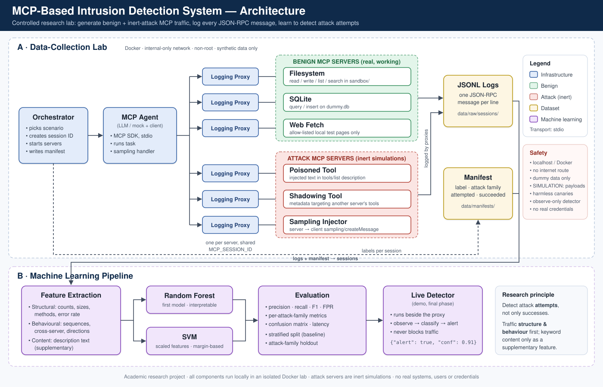

# MCP-IDS — An Intrusion Detection System for Model Context Protocol Traffic

> **Academic research project.** Everything runs locally in an isolated lab with
> synthetic data. Attack servers are *inert simulations* that produce suspicious
> MCP telemetry; they never exploit anything. See [SECURITY.md](SECURITY.md).



## The research question

> *Can structural and behavioural characteristics of MCP traffic help identify
> suspicious MCP activity — beyond just looking for attack keywords?*

## What is MCP, in one paragraph?

The **Model Context Protocol (MCP)** is an open standard that lets an AI
application (the *client* / agent) plug into external *servers* that offer
**tools** ("read a file", "query a database"), **resources**, and **prompts**.
Client and server talk using **JSON-RPC 2.0** messages such as `initialize`,
`tools/list`, `tools/call`, and — in the other direction — server-initiated
requests like `sampling/createMessage`.

## Why is that a security problem?

The agent's LLM *reads text supplied by servers* — tool names, tool
descriptions, tool results — and decides what to do next. A malicious or
compromised server can therefore try to steer the model with that text
(e.g. a tool description saying "ignore previous instructions…"). Because one
agent often mounts several servers at once, one bad server can also try to
influence how tools from *other*, trusted servers are used. Traditional network
IDSs don't understand this layer. This project builds a lab to study it.

## How the project works

1. **Data-collection lab** — an orchestrator runs scripted scenarios; an MCP
   agent talks to benign and inert-attack MCP servers; a **logging proxy**
   between them records every JSON-RPC message to JSONL; a **manifest** labels
   each session (benign / attack family / attempted / succeeded).
2. **ML pipeline** — reconstruct sessions, extract structural, behavioural and
   content features, train seven models (Random Forest, SVM, XGBoost, RF + XGBoost, Decision Tree,
   a 1-D CNN on the features, and a CNN that reads the raw messages), tune them on training tasks
   only, evaluate them on tasks they never saw (including held-out attack families), and run a
   live detector demo.

Full detail: [ARCHITECTURE.md](ARCHITECTURE.md).

## Project status

| Phase | Deliverable | Status |
|---|---|---|
| 1 | Skeleton, Docker baseline, docs, filesystem MCP server, basic client, smoke tests | ✅ done |
| 2 | MCP agent driver (deterministic mock + Claude backend) | ✅ done |
| 3 | Logging proxy (JSONL wire logs + session reader) | ✅ done |
| 4 | SQLite + web-fetch benign servers, test website, benign tasks (38 since lab 0.9.0; 42 since lab 0.9.1, incl. two benign servers that use sampling) | ✅ done |
| 5 | Orchestrator, labelled manifest, batch runs, verify | ✅ done |
| 6 | Poisoned-tool simulation: benign/poisoned calculator twins, 5 payload styles, canary success check | ✅ done |
| 7 | Inert cross-server shadowing metadata with a matched harmless control | ✅ done |
| 8 | Inert server-initiated sampling request with a fixed client callback | ✅ done |
| 9 | Reproducible balanced dataset across benign + three existing simulations | ✅ done (verified run `data/phase9_081_targeted/`; current dataset `data/combined_canonical_20261010/`, 2,220 sessions) |
| 10 | Structural, behavioural and content features with lab marker neutralization | ✅ implemented; new family-specific traffic features |
| 11–12 | Seven models (RF, SVM, XGBoost, RF + XGBoost, Decision Tree, 1-D CNN, raw-traffic CNN), hyperparameter tuning on training tasks, task-grouped split, leakage guard | ✅ done |
| 13 | Nested task-grouped CV with 95 % CIs (headline), payload-style and attack-family holdouts, ablation, benign-only anomaly detection, external benign tests | ✅ done |
| 14 | Live detector: observe-only sidecar, early + final verdicts, JSONL alerts, replay mode | ✅ done |

## Current results (2026-10-10)

Experiment `exp_017_combined_canonical_20261010`: 2,220 sessions (1,860 benign / 360 inert attacks,
42 tasks), every model tuned inside each training fold, tested on tasks it never saw (nested
task-grouped cross-validation).

| Model | F1 [95 % CI] | False-positive rate |
|---|---|---|
| **RF + XGBoost** (live detector default) | **0.796** [0.33, 1.00] | 0.2 % |
| XGBoost | 0.791 [0.33, 1.00] | 0.4 % |
| Decision Tree | 0.789 [0.33, 1.00] | 0.4 % |
| SVM | 0.730 [0.26, 0.99] | 3.1 % |
| Random Forest | 0.710 [0.33, 1.00] | 0.0 % |
| 1-D CNN | 0.704 [0.24, 0.98] | 3.9 % |
| Raw-traffic CNN | 0.377 [0.00, 0.88] | 1.5 % |

* Every poisoned-tool and shadowing attack on an unseen task is caught by the best models; no
  sampling attack is, because all of them come from one task (the main remaining limitation).
* The tool-description (content) features carry the detection: alone they reach F1 0.80.
* 0 false alarms by any model on 200 outside benign sessions (104 from unseen tasks).
* A random train/test split would report a perfect 1.00 for every model, because sessions of the
  same task land on both sides (185 of 407 test sessions were copies). The saved models now use a
  task-grouped split.
* The raw-traffic CNN is a documented negative result: once a wording shortcut in the data was
  removed, it generalised far worse than the hand-made features.

Details: [docs/ml.md](docs/ml.md#current-state-2026-10-10-read-this-first) and
[docs/experiments.md](docs/experiments.md#2026-10-10-tuning-raw-traffic-cnn-benign-sampling-servers-task-grouped-split).

## Quick start (local, Windows / Linux / macOS)

Requires Python 3.11+.

```bash
python -m venv .venv
# Windows:  .venv\Scripts\activate      Linux/macOS:  source .venv/bin/activate
pip install -r requirements.txt
pip install -r requirements-torch.txt     # CPU-only PyTorch for the two CNNs (separate index)

pytest -v                                  # smoke tests
python -m agent.client --server filesystem # Phase 1: scripted MCP session (also: sqlite, web_fetch)
python -m agent.driver --task fs_report_digest --seed 1   # Phase 2: mock agent (logged by proxy)
python -m proxy.reader                                    # Phase 3: list logged sessions
python -m proxy.reader latest                             # Phase 3: newest session's timeline
python -m agent.driver --task multi_price_check --seed 2  # Phase 4: three servers in one session
python -m orchestrator.main list                          # Phase 5: scenarios
python -m orchestrator.main batch --scenarios benign --parallel 4 --seed 100
python -m orchestrator.main verify                        # Phase 5: manifest <-> logs check
python -m orchestrator.main run attack:poisoned_tool:calc_add --seed 4 --susceptibility 1.0  # Phase 6
python -m orchestrator.main --data-dir data/phase7_smoke_tmp batch --scenarios benign:fs_shadowing_probe,attack:shadowing:fs_shadowing_probe --parallel 1 --seed 7 --susceptibility 1.0
python -m orchestrator.main --data-dir data/phase8_smoke_tmp batch --scenarios benign:fs_sampling_probe,attack:sampling_injection:fs_sampling_probe --parallel 1 --seed 30
python -m agent.driver --task fs_report_digest --llm claude  # real model (needs ANTHROPIC_API_KEY)
```

### Phase 9 dataset generation (Docker)

The command writes a new dataset to `data/phase9_verified/` and refuses to overwrite a
non-empty destination. It runs the existing benign and inert attack
simulations with the deterministic mock agent; it does not alter `data/try6`.

```bash
docker compose build
docker compose run --rm lab python -m scripts.generate_phase9 --output /lab/data/phase9_081_targeted --seed 9000 --parallel 4 --sessions-per-family 30
docker compose run --rm lab python -m scripts.generate_phase9 --output /lab/data/phase9_081_targeted --verify-only
```

The previous Phase 9 directories use lab 0.7.0 and have known sampling-capability,
twin-result, and session-completeness issues. Preserve them as historical records;
do not use them for multi-family ML. The commands above create a fresh balanced
dataset and never overwrite `data/try6` or earlier Phase 9 data.
An intermediate directory named `data/phase9_081_balanced/` is a preserved,
interrupted attempt that predates family-probe filtering; it is incomplete and
must not be used. The verified run is `data/phase9_081_targeted/`.

### Current ML pipeline (2026-10-10, final dataset)

```bash
# Data (Docker): compose the final dataset and extract features; see docs/experiments.md for every source
docker compose run --rm lab python -m scripts.compose_dataset --source /lab/data/combined_sampling_20261010 --source /lab/data/benign_unique_090 --output /lab/data/combined_canonical_20261010
docker compose run --rm lab python -m features.extractor --data-dir /lab/data/combined_canonical_20261010 --out /lab/data/combined_canonical_20261010_ml
# Train all seven models; --tune picks each model's settings on training tasks only
python -m ml.train --features data/combined_canonical_20261010_ml --models models/combined_canonical_20261010 --seed 42 --test-size 0.3 --tune
# Evaluate; --nested-tuning makes the headline a nested task-grouped CV (about 8 hours on a laptop)
python -m ml.evaluate --features data/combined_canonical_20261010_ml --models models/combined_canonical_20261010 --results results/combined_canonical_20261010 --experiment-id exp_017_combined_canonical_20261010 --nested-tuning
# Every model's verdict on the same sessions, side by side
python -m scripts.compare_models --models models/combined_canonical_20261010 --data-dir data/demo_live
```

The split is task-grouped by default (`--split stratified` reproduces the earlier random split).

### ML pipeline (Phases 10–13, on the regenerated Phase 9 dataset)

```bash
# 1. Extract features (reads raw dataset, writes separate derived-data directory)
python -m features.extractor --data-dir data/phase9_081_targeted --out data/phase9_081_ml
# 2. Train RF, SVM, XGBoost and RF + XGBoost with label+family stratification and fixed seed
python -m ml.train --features data/phase9_081_ml --models models/phase9_081 --seed 42 --test-size 0.3
# 3. Evaluate baseline, payload-style holdout, and family holdout
python -m ml.evaluate --features data/phase9_081_ml --models models/phase9_081 --results results/phase9_081 --experiment-id exp_003_phase9_081
# Classify a single logged session with a saved model
python -m ml.inference --model models/phase9_081/random_forest.joblib --data-dir data/phase9_081_targeted --session SESSION_ID
# Held-out test: unique benign corpus (benign only), then score saved models on it
docker compose run --rm lab python -m scripts.generate_benign_corpus --output /lab/data/benign_unique_081
docker compose run --rm lab python -m features.extractor --data-dir /lab/data/benign_unique_081 --out /lab/data/benign_unique_081_ml
python -m ml.evaluate_external --features data/benign_unique_081_ml --model models/phase9_081/random_forest.joblib --model models/phase9_081/svm.joblib --results results/benign_unique_081_eval
```

Lab 0.9.0 (more benign tasks, optional reworded descriptions, retraining as
`exp_005`): task-grouped SVM false-positive rate fell from 7.8 % to 1.7 %, but
every model flags benign sessions whose tool descriptions use second-person
prose; see [docs/ml.md](docs/ml.md#lab-090-more-benign-variety-retraining-and-a-wording-robustness-test)
and the reproduce commands in [docs/experiments.md](docs/experiments.md).

Held-out result (2026-10-06): on 200 unseen, unique benign sessions the
`exp_003` Random Forest raised 1 false alarm (FPR 0.5 %), the SVM 93 (FPR 47 %).
See [docs/ml.md](docs/ml.md#held-out-unique-benign-corpus-2026-10-06-does-anything-change).

### Expanded 0.9.0 dataset and retraining (2026-10-06)

The latest collection is in `data/phase9_expanded_20261006/` (720 matched
sessions: 360 benign and 120 attacks per family) plus
`data/benign_varied_090_expanded_20261006/` (634 benign sessions, 38 tasks,
three reworded description styles). Their verified composition is
`data/combined_expanded_20261006/` (1,354 sessions, 31,388 MCP wire events).
Raw source datasets remain separate and unchanged. Features, models, results,
and experiment metadata are in `data/expanded_20261006_ml/`,
`models/expanded_20261006/`, `results/expanded_20261006/`, and
`experiments/exp_006_expanded_20261006/`.

The random 70/30 split scores 1.000 for every model, but this is optimistic:
185/407 test rows duplicate a training feature vector. Task-grouped CV gives
F1 0.780 (RF), 0.759 (SVM) and 0.800 (XGBoost and RF + XGBoost, added
2026-10-08); every model misses all sampling-injection sessions. A full
from-scratch re-run on this, the largest dataset (`exp_008_expanded_20261008`,
models in `models/expanded_20261008/`), reproduces every number exactly; see
[docs/experiments.md](docs/experiments.md#exp_008_expanded_20261008-full-re-run-on-the-largest-dataset-2026-10-08).
Leave-one-family-out recall is zero for poisoned-tool and sampling-injection.
See [docs/ml.md](docs/ml.md) and [docs/experiments.md](docs/experiments.md)
before interpreting the baseline.

Reproduce into fresh, empty output folders:

```bash
docker compose run --rm lab python -m scripts.generate_benign_corpus --output /lab/data/benign_varied_090_expanded_20261006 --seed-base 70000 --search 2000 --parallel 4 --server-mix both --description-variant cycle
docker compose run --rm lab python -m scripts.generate_phase9 --output /lab/data/phase9_expanded_20261006 --seed 90000 --parallel 4 --sessions-per-family 120
docker compose run --rm lab python -m scripts.compose_dataset --source /lab/data/phase9_expanded_20261006 --source /lab/data/benign_varied_090_expanded_20261006 --output /lab/data/combined_expanded_20261006
docker compose run --rm lab python -m features.extractor --data-dir /lab/data/combined_expanded_20261006 --out /lab/data/expanded_20261006_ml
docker compose run --rm lab python -m ml.train --features /lab/data/expanded_20261006_ml --models /lab/models/expanded_20261006 --seed 42 --test-size 0.3
docker compose run --rm lab python -m ml.evaluate --features /lab/data/expanded_20261006_ml --models /lab/models/expanded_20261006 --results /lab/results/expanded_20261006 --experiment-id exp_006_expanded_20261006 --experiments-dir /lab/experiments
```

### Live detector (Phase 14, observe-only)

Default model (since 2026-10-10): `models/combined_canonical_20261010/rf_xgb.joblib`, the tuned
RF + XGBoost soft vote trained on the final 2,220-session dataset; pass `--model` to use any other
saved pipeline, including the raw-traffic CNN (`cnn_raw.joblib`).

```bash
# Terminal 1: watch the folder the logging proxies write to
python -m detector.detector watch --log-dir data/live/raw/sessions
# Terminal 2: run lab sessions into that folder
python -m orchestrator.main --data-dir data/live batch --scenarios benign --parallel 2 --seed 900
# Judge every session of a finished dataset (read-only)
python -m detector.detector replay --data-dir data/phase9_081_targeted
```

Run dataset generation, then steps 1–3 in order to reproduce `exp_003_phase9_081`.
Results are written under `results/phase9_081/`.
**The dataset is too small to establish strong real-world generalization**,
see [docs/ml.md](docs/ml.md).

## Quick start (Docker — the isolated lab)

Requires Docker Desktop / Docker Engine with Compose v2.

```bash
docker compose build
docker compose run --rm lab                          # tests inside the container
docker compose run --rm lab python -m agent.client   # demo inside the container
docker compose run --rm lab python -m agent.driver --task multi_price_check --seed 2
docker compose run --rm lab python -m orchestrator.main batch --scenarios benign --parallel 4
docker compose down                                  # stops the testweb container
```

## Repository layout

```
agent/          client.py (MCP connection), driver.py (agent loop), llm.py (mock/Claude), tasks.py
common/         Shared code: server registry, per-session lab environment (sandbox, DB, site)
servers/benign/ filesystem, sqlite (+ seeded DB builder), web_fetch (+ synthetic test site), calculator,
                shadowing/sampling controls, writing_assistant + helpdesk (benign servers that use sampling)
servers/attack/ poisoned_tool, shadowing, sampling_injector (inert simulations)
proxy/          Logging proxy, JSONL logger, log reader
orchestrator/   Scenarios, session runner, labelled manifest, verify
features/       Session loading + neutralization, structural / behavioural / content features, extractor
ml/             Leakage-guarded dataset loading, seven model pipelines (models.py, cnn.py, raw_cnn.py),
                raw-traffic view (raw.py), tuning (tuning.py), train, evaluate, evaluate_external, inference
models/         Trained pipelines + metadata, one folder per run (current: models/combined_canonical_20261010/)
results/        Evaluation outputs: metrics, report, plots (current: results/combined_canonical_20261010/)
detector/       Live detector (observe-only sidecar) and alert format
sandbox/        Synthetic files served by the filesystem server
data/           Generated datasets, e.g. try6/, phase9_081_targeted/ and separate feature tables
experiments/    One folder per experiment: config, metrics, notes
docs/           Topic documentation and diagrams
docker/         Dockerfile; wheels/ = optional offline PyTorch wheels (see docker/wheels/README.txt)
tests/          pytest suite
```

## Documentation

* [ARCHITECTURE.md](ARCHITECTURE.md) — components, data flow, design decisions
* [SECURITY.md](SECURITY.md) — safety scope, threat model, isolation
* [docs/agent.md](docs/agent.md) — the agent, mock vs Claude brain, reproducibility
* [docs/llm_api_setup.md](docs/llm_api_setup.md) — Claude API setup, key safety, cost estimates
* [docs/proxy.md](docs/proxy.md) — the logging proxy and its guarantees
* [docs/servers.md](docs/servers.md) — benign servers, their safety controls, the task list
* [docs/orchestrator.md](docs/orchestrator.md) — scenarios, manifest, reproducibility, verification
* [docs/dataset.md](docs/dataset.md) — raw log, manifest and feature dataset formats
* [docs/attacks.md](docs/attacks.md) — inert poisoned-tool, shadowing and sampling simulations
* [docs/ml.md](docs/ml.md) — features, neutralization, leakage prevention, models, evaluation, results, limitations
* [docs/experiments.md](docs/experiments.md) — experiment log (`exp_001` … `exp_017`; current: `exp_017`)
* [docs/detector.md](docs/detector.md) — live detector design, alert format, results, limitations

The current verified Phase 9 dataset is `data/phase9_081_targeted/`. The
older `data/phase9_verified/` uses lab 0.7.0 and has known label/result
artifacts; `data/phase9/` failed lifecycle verification. Both remain preserved
as historical records and should not be used for current multi-family ML.
