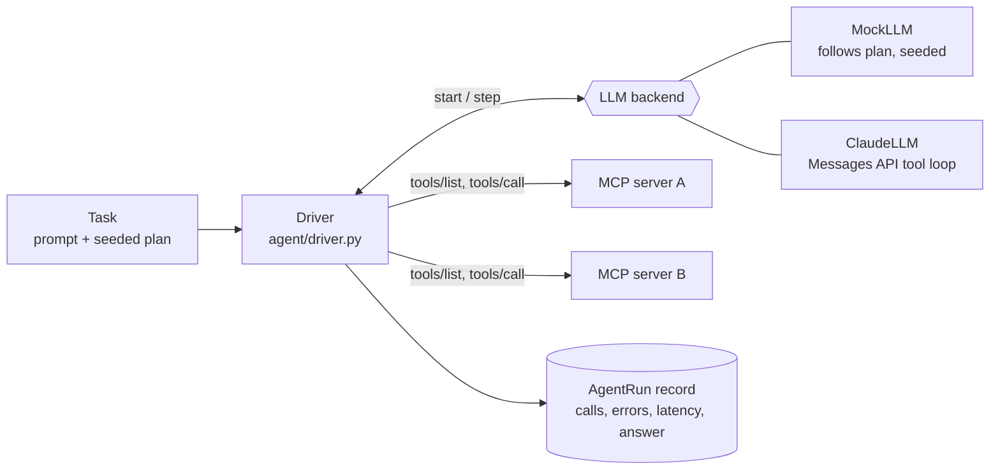

# The MCP agent (Phase 2)

## Simple version
The agent is the "user side" of MCP. It receives a task ("summarise my
notes"), looks at which tools the connected MCP servers offer, and calls them
until the task is done. Its *brain* is swappable:

| Brain | When | Cost | Reproducible? |
|---|---|---|---|
| **Mock** (default) | bulk dataset generation, tests, demos | free, offline | yes, exactly, from a seed |
| **Claude** | measuring whether attacks *actually* influence a real model | API usage | no (model output varies) |

## Architecture



## How one session runs
1. **Fresh sandbox.** A temporary copy of `sandbox/` is made, so sessions never
   affect each other or the repo's seed data (`common/sandbox.py`).
2. **Connect** to each server the task needs (stdio child processes) with the
   shared `MCP_SESSION_ID`.
3. **Discover tools** with `tools/list` and rename them `<server>__<tool>`
   (e.g. `filesystem__read_file`) so two servers can't collide.
4. **Loop** (`max_steps`, default 12): backend decides -> driver calls the
   right server -> results are fed back. Unknown tool names come back to the
   model as errors instead of crashing the run.
5. **Record** an `AgentRun`: every call with server, original tool name,
   arguments, error flag, latency, plus the final answer and `stop_reason`
   (`end_turn`, `max_steps`, `refusal`, ...).

## The mock brain: realistic *and* reproducible
Each task has a `plan` of steps. Per step:
* `p` - probability it happens (exploratory `list_directory`, extra reads);
* `choices` - alternative arguments (e.g. the right path or a plausible wrong one);
* `on_error` - one retry with corrected arguments (an agent fixing its mistake).

`random.Random(seed)` decides all of this, so seed 7 always produces the same
session, while 100 seeds produce 100 varied benign sessions. Without that
variety a classifier could learn "anything not identical to the benign
template is an attack", which would be meaningless.

Example (same task, three seeds):
```
seed 0: read_file reports/report.txt -> ERROR, read_file report.txt, write_file digest
seed 1: list_directory ., read_file reports/report.txt -> ERROR, read_file report.txt, write_file digest
seed 2: read_file report.txt, write_file digest
```

## The Claude brain
`agent/llm.py::ClaudeLLM` uses the official `anthropic` SDK with a manual
tool-use loop. Design points you should be able to explain:
* **Model** `claude-opus-5-5` by default (`LLM_MODEL` to change); depth/cost via
  `LLM_EFFORT` (`low`...`max`, default `medium`). Thinking is adaptive on this
  model, so no `thinking` parameter is sent.
* **Append-only history**: each response's full content is appended unchanged;
  all tool results of a turn go back in one user message, with `is_error` set
  for MCP tool errors.
* **Refusal fallback** (`fallbacks="default"`): if the model declines on safety
  grounds, the API retries on a fallback model. If the whole chain refuses, the
  run ends with `stop_reason="refusal"`. For attack sessions a refusal is a
  data point, not a crash.
* **Neutral system prompt**: it does *not* tell the model to watch for
  injections. We want to observe an ordinary agent; adding defences would bias
  `attack_succeeded`.

### Running with Claude
Full setup and cost guide: [llm_api_setup.md](llm_api_setup.md). Requires credentials (`ANTHROPIC_API_KEY`) and internet. **It cannot run inside
the lab container**, because the lab network is deliberately internal-only.
Run it from the host venv:
```bash
python -m agent.driver --task fs_summarize_notes --llm claude
```

## Tasks available (Phase 2)
`fs_summarize_notes`, `fs_find_data_files`, `fs_report_digest`,
`fs_explore_documents`, all filesystem-only. More tasks arrive with the SQLite
and web-fetch servers (Phase 4); scenarios that mix tasks and servers arrive
with the orchestrator (Phase 5).

## Not yet implemented (by design)
* **Sampling handler** (`sampling/createMessage`): Phase 8, together with the
  sampling-injection server.
* **`attack_succeeded` measurement** (canary detection): Phases 6-8.
* (Done in Phase 3) every session now runs behind the logging proxy by default;
  `--no-proxy` disables it. The driver's own call record is cross-checked
  against the proxy log in `tests/test_proxy.py`.
