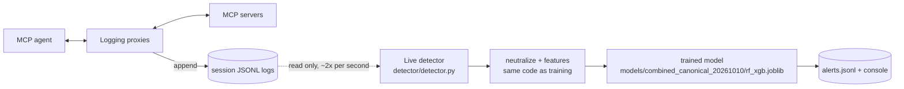

# Live detector (Phase 14)

> Observe-only demonstration. It **never blocks, delays or modifies** MCP
> traffic; it only reads logs and writes alerts.

## Simple version
While the lab runs, each logging proxy appends every MCP message to a JSONL
file. The detector is a separate program that keeps reading those files.
For each session it rebuilds what has happened so far, turns it into the
same 65 features used in training (or, for the raw-traffic CNN, the same masked message text),
and asks the trained model "does this look like an attack attempt?". It raises:

* an **early alert** the first time a *running* session looks suspicious;
* one **final verdict** (benign or attack) when the session has ended.



## Why a sidecar instead of putting the model inside the proxy
| | Inside the proxy | Sidecar (chosen) |
|---|---|---|
| Can delay traffic | yes (model on the forwarding path) | no |
| A detector crash breaks MCP | yes | no; the lab keeps logging |
| Can block traffic | possible | impossible by construction |
| Detection delay | none | up to one polling interval (0.5 s default) |

Blocking was explicitly out of scope ("observe, classify, log, alert"), so
the sidecar's small delay is the right trade-off.

## How it works (`detector/detector.py`)
1. **Polling.** Every `--interval` seconds (default 0.5) it checks each
   session folder. Unchanged folders (same file names and sizes) are skipped.
2. **Tolerant reading.** A proxy may be in the middle of writing a line. A
   trailing line without a newline is skipped now and read on the next poll.
3. **Same preprocessing as training.** Events go through
   `features.session.session_from_events` (neutralization) and
   `features.extractor.features_from_session`, the exact functions used to
   build `features.csv`. A test checks live and offline features are identical.
4. **Model.** `ml.inference.Detector` loads the saved pipeline and its
   feature list. The leakage guard runs again at load time.
5. **Session complete** = every server log of the session has ended:
   a clean `proxy/stop`, or a `proxy/client_eof` with no unanswered requests
   (`proxy.reader.log_end_state`, the same rule as `verify`). Then exactly one
   final verdict is emitted.
6. **Early verdict** = while incomplete, the session is re-classified when new
   lines arrive. Only suspicion is reported, at most once per session.
7. Sessions that had already finished before the detector started are
   ignored unless `--include-existing` is given.

## Alert format (`detector/alerts.py`)
One JSON object per line in `alerts.jsonl` (default `data/alerts/alerts.jsonl`). Shape of an alert (values illustrative):

```json
{"alert": true, "prediction": "attack", "confidence": 0.97, "score": 0.97,
 "session_id": "…", "stage": "early", "model": "random_forest",
 "n_messages": 5, "servers": ["calculator"], "detection_ms": 51.2,
 "evidence": {"tools_list_resp_size_max": 1906.0, "directive_word_count": 5, "...": 0},
 "timestamp": "2026-10-03T11:44:40.418+00:00"}
```

* `confidence` = probability of `attack` for the probabilistic models (Random
  Forest, XGBoost, RF + XGBoost). For the SVM it is `null` and `score` holds
  the signed margin.
* `evidence` = a few feature values to help an analyst see *why*. These are
  values, not an explanation of the model.

## Commands
```bash
# Terminal 1: watch the folder the proxies write to
python -m detector.detector watch --log-dir data/live/raw/sessions
# Terminal 2: run lab sessions into that folder
python -m orchestrator.main --data-dir data/live batch --scenarios benign --parallel 2 --seed 900
# Judge every session of a finished dataset (read-only)
python -m detector.detector replay --data-dir data/phase9_081_targeted
```
Options: `--model` (default `models/combined_canonical_20261010/rf_xgb.joblib`, the tuned
RF + XGBoost soft vote trained on the final 2,220-session dataset: nested task-grouped F1 0.796,
false-positive rate 0.2 %; earlier defaults were `models/expanded_20261008/rf_xgb.joblib` and,
before 2026-10-08, `models/phase9_081/random_forest.joblib`; any saved pipeline works,
including the raw-traffic CNN `cnn_raw.joblib`), `--alerts`,
`--interval`, `--no-early`, `--include-existing`, `--max-sessions N`, `--timeout S`.

## Results (all actually run, 2026-10-03 and 2026-10-04)

**1. Historical replay of `data/try6` with the old try6 model (read-only; dataset SHA-256 unchanged afterwards)**

| Sessions | Alerts | TP | FP | TN | FN | Median detection time |
|---|---|---|---|---|---|---|
| all 65 (*mostly training data*) | 25 | 25 | 0 | 40 | 0 | ≈ 53 ms |
| **20 held-out test sessions** | 8 | 8 | 0 | 12 | 0 | |

The replay detects that the model was trained on this dataset (same SHA-256)
and reports the held-out test sessions separately; only those reflect unseen
data. They match the offline evaluation exactly.

**2. Live watch, 6 new benign sessions** (filesystem, sqlite, web_fetch,
calculator, a 3-server and a 4-server session, seeds 900-905): 6 final
verdicts, **0 alerts**, each within about a second of the session ending,
≈ 50-60 ms per verdict. These sessions were never seen in training. No new
attack sessions were generated for this phase.

**3. Early-alert timing (streaming replay).** Each of the 20 held-out
`data/try6` sessions was written line by line into a temporary folder, with
the detector checking after every line:

| | Sessions | Early alert raised | Alert before the first `tools/call` |
|---|---|---|---|
| attack | 8 | 8 | **8 / 8** (right after the poisoned `tools/list` response) |
| benign | 12 | 0 | – |

So in this lab the attempt is flagged **before the agent uses any tool**.
That's possible because the poisoned metadata arrives in `tools/list`. In the
real watcher the delay is additionally up to one polling interval.

**4. Live watch, 40 benign sessions, lab 0.6.0** (run by the project author,
2026-10-03 17:35–17:37 IST, `data/live`, alerts in `data/alerts/alerts.jsonl`):
40/40 sessions judged, **0 alerts**, highest attack probability 0.06,
detection 32–76 ms (median 57 ms). `verify`: consistent.

**5. Historical live watch after lab 0.8.0 (drift check), 2026-10-04.** Same model
(`models/try6/random_forest.joblib`, trained on lab-0.6.0 data). All 44
benign scenarios, recorded locally with lab 0.8.0 (`--parallel 4 --seed 1000`,
`data/live_080`, alerts in `data/alerts/live_080.jsonl`). Lab 0.8.0 adds
six-server scenarios with two control servers the model has never seen, and
every `initialize` request is 176 instead of 163 bytes.

| Check | Result |
|---|---|
| Sessions | 44/44 OK, `verify` consistent, all 44 judged (final verdicts only) |
| False alarms | **0** |
| Detection time | 41–73 ms per session (median 57 ms) |
| Highest attack probability | **0.15** (lab 0.6.0 run: 0.06); alert threshold 0.5 |

Highest attack probability by number of mounted servers:

| Servers | 1 | 2 | 3 | 6 |
|---|---|---|---|---|
| Highest attack probability | 0.06 | 0.08 | 0.00 | **0.15** |

Interpretation:
* The larger `initialize` request did not matter; sessions with the old
  server mixes score as before.
* The higher scores are concentrated in **six-server sessions**, which contain
  the unseen control servers (tool descriptions not in training, tool names
  that duplicate other servers'). This is measurable **drift**, still well
  below the threshold.
* This run measures **false alarms only**. No attack sessions were run, and
  the model was never trained on shadowing or sampling, so nothing here says
  whether those families would be detected.
* The previous model covered only poisoned-tool traffic. The default now uses the lab-0.8.1 model; its family-holdout limitations are reported below and in [ml.md](ml.md#current-multi-family-run-exp_003_phase9_081).

**6. Lab 0.8.1 dataset replay with the current default model** (`data/phase9_081_targeted`, 2026-10-04):

| Sessions | Alerts | TP | FP | TN | FN | Median detection time |
|---|---:|---:|---:|---:|---:|---:|
| all 180 (includes training sessions) | 90 | 90 | 0 | 90 | 0 | 55.25 ms |
| **54 held-out baseline test sessions** | 27 | 27 | 0 | 27 | 0 | included above |

The replay itself reports `model_trained_on_this_dataset: true`; only the 54
held-out baseline test sessions are unseen data for this model. This does not
contradict the weaker family-holdout experiment: the baseline split contains
examples from all three families in training.

## Limitations
* **Partial sessions.** Early verdicts classify incomplete sessions with a
  model trained on complete ones. That worked here (no early false alarms in
  12 benign streams + 90 live benign sessions), but it is a heuristic, not a
  validated design.
* **Same model, same caveats** as [ml.md](ml.md): this small synthetic corpus
  has fixed benign descriptions and author-designed payloads. Family holdout
  found no transfer to the sampling family for either model; baseline replay
  results do not test unseen attack families.
* **Environment shift.** The Phase 6 model was trained on sessions recorded
  locally (`127.0.0.1:18080`). The current model and dataset were both recorded
  in Docker (`testweb:8080`); do not apply either model across environments
  without validation.
* **Polling, not streaming.** Up to `--interval` seconds of delay; re-reads a
  changed session completely (fine for lab-sized sessions).
* **No blocking, by design.** Moving to prevention would require an inline
  component and much stronger evidence of low false-positive rates.

## Tests (`tests/test_detector.py`)

Latest demo run (2026-10-10, `demo.ps1`): verdicts for a benign SQLite session, a benign
help-desk session that uses sampling, and an inert poisoning attack, about 40 ms each; the
attack alerted (P = 0.95), both benign sessions passed.

Tolerant reading of half-written lines · live features identical to offline
features · one early + one final alert with an always-attack stub model · no
early alerts with an always-benign stub · sessions finished before start are
ignored · **observe-only**: logs byte-identical after replay and watch, no
alerts written into the dataset · replay counts · alert JSON format.
