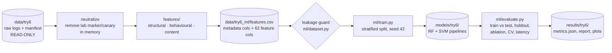

# ML methodology (Phases 10–13)

> **This experiment demonstrates the functionality of the ML pipeline, but the
> dataset is too small to establish strong real-world generalization.**

## Simple version
Each recorded MCP session becomes one row of numbers (features) describing
*how much* traffic there was, *what the agent did*, and *what the tool
metadata said*. Models learn from those rows to label a session **benign** or
**attack** (attack = an attack was *attempted*, whether or not it succeeded),
and are then tested on sessions of tasks they never saw. The project started
with a Random Forest and an SVM; since 2026-10-10 it has seven models (six on
the features, one reading the raw messages), all tuned on training data only.
The diagram below shows the original pipeline; the current state follows it.

## Current state (2026-10-10): read this first

| Item | Value |
|---|---|
| Dataset | `data/combined_canonical_20261010`: 2,220 sessions (1,860 benign / 360 attack), 42 tasks, 52,162 MCP messages, lab 0.9.0 + 0.9.1 |
| Attack families | poisoned tool, shadowing, sampling injection: 120 inert sessions each |
| Benign variety | 38 original tasks in 4 description wordings, plus 4 tasks on two benign servers that legitimately use MCP sampling |
| Features | 65 (26 structural, 19 behavioural, 20 content), neutralized, leakage-guarded |
| Models | Random Forest, SVM, XGBoost, RF + XGBoost, Decision Tree, 1-D CNN (features); raw-traffic CNN (bytes of the masked messages) |
| Tuning | `ml/tuning.py`: grid per model, scored by task-grouped inner CV on training rows only; default wins ties |
| Headline protocol | nested task-grouped CV: `GroupKFold(5)` on `task_id`, tuning inside every outer training fold |
| Saved models' split | task-grouped: 14 of 42 tasks held out (680 test sessions); every attack family kept in training |
| Results | `results/combined_canonical_20261010/`, `experiments/exp_017_combined_canonical_20261010/` |
| Live detector default | `models/combined_canonical_20261010/rf_xgb.joblib` |

| Model | F1 [95 % task-bootstrap CI] | Recall | FPR | Recall poisoned / shadowing / sampling |
|---|---|---|---|---|
| RF + XGBoost | **0.796** [0.33, 1.00] | 0.667 | 0.002 | 1.00 / 1.00 / 0.00 |
| XGBoost | 0.791 [0.33, 1.00] | 0.667 | 0.004 | 1.00 / 1.00 / 0.00 |
| Decision Tree | 0.789 [0.33, 1.00] | 0.667 | 0.004 | 1.00 / 1.00 / 0.00 |
| SVM (RBF) | 0.730 [0.26, 0.99] | 0.667 | 0.031 | 1.00 / 1.00 / 0.00 |
| Random Forest | 0.710 [0.33, 1.00] | 0.550 | 0.000 | 1.00 / 0.65 / 0.00 |
| 1-D CNN | 0.704 [0.24, 0.98] | 0.653 | 0.039 | 0.96 / 1.00 / 0.00 |
| Raw-traffic CNN | 0.377 [0.00, 0.88] | 0.250 | 0.015 | 0.75 / 0.00 / 0.00 |

What it means:

* **About 0.80 is the ceiling for these features**: every sampling attack comes from one task,
  so a model that has never seen a sampling attack catches none (recall at most 240/360 = 0.667,
  F1 at most 0.800). Three models reach it. The intervals overlap widely, so no model is
  significantly better than another.
* **The tool-description text carries the detection.** Task-grouped ablation: content features
  alone F1 0.72–0.80; structural alone 0.11–0.26; behavioural alone 0.10–0.22.
* **Benign sampling servers matter.** Models trained before they existed flagged them as attacks
  (SVM 103 of 232, 1-D CNN 169 of 232). After retraining the tree models raise none; the SVM
  (56) and 1-D CNN (71) still distrust unfamiliar sampling tasks.
* **No false alarms on outside benign traffic**: every model raises 0 on the 200 sessions of
  `benign_unique_081`, 104 of them from tasks it never trained on.
* **The raw-traffic CNN is a negative result.** After a shift-invariance bug fix it scored 0.726
  on the 1,586-session data, but that relied on a wording confound (every attack used the
  original tool wording, 808 benign sessions reworded ones). With the original-wording benign
  corpus added, it falls to 0.377: on 42 tasks of lab traffic, a byte-level model generalises
  far worse than hand-made content features.
* **Tuning does not always transfer** with six attack tasks (e.g. SVM 0.789 untuned vs 0.730
  tuned); nested CV reports this instead of hiding it.

How the numbers developed (headline F1 of the best model): 0.800 on 1,354 sessions with a random
baseline split and untuned models (exp_008, 2026-10-08) → 0.797 on 1,586 sessions with benign
sampling, task-grouped split and tuning (exp_016) → 0.796 on 2,220 sessions without the wording
shortcut (exp_017). The headline barely moved; what changed is that it now holds without the
memorised duplicates and shortcuts, and false alarms were measured on the situations that
produced them. Full log and reproduce commands: [experiments.md](experiments.md). A
beginner-level walk-through of the whole pipeline (flowcharts, formulas, glossary) is the
project's "How the Machine Learning Works" guide.

## Historical Phase 6 dataset (`exp_001_try6_baseline`)
This section records the original Phase 6 experiment on `data/try6` (lab
0.6.0, poisoned-tool family only), treated as read-only. It remains useful as
a historical single-family baseline; the current three-family run is reported
below under `exp_003_phase9_081`.

| Property | Value (verified from files) |
|---|---|
| Sessions | 65 (all `status: ok`), 65 unique IDs, no orphan logs |
| Labels | 40 benign, 25 attack (all `poisoned_tool`) |
| Payload styles | overt 5, tagged 5, polite 5, padded 5, param 5 |
| Attacks that influenced the mock agent | 11 / 25 |
| Events | 1661 total, 1275 MCP messages (rest are proxy lifecycle events) |
| Malformed lines / events missing fields | 0 / 0 |
| SHA-256 (manifest + all logs) | `0784a0f970421d70878938ac3cb6a4d62e1698ac63be75c761100114ccac7337` |

The hash is recomputed by the extractor and stored with every model; it was
identical before and after feature extraction (the source is not modified).

## Phase 10: feature engineering

Code: `features/` (`session.py`, `structural.py`, `behavioral.py`,
`content.py`, `extractor.py`). Each feature is declared once with its
documentation (`features/base.py: FeatureSpec`); `feature_schema.json` is
generated from those declarations, and the extractor fails if a module
returns anything other than what it declares.

| Group | # | What it captures | Examples |
|---|---|---|---|
| Structural | 25 | volume, message kinds, directions, errors, sizes | `n_messages`, `n_tools_call`, `error_rate`, `request_response_ratio`, `size_max`, `tools_list_resp_size_max` |
| Behavioural | 18 | the *sequence* of tool use, without tool names or argument values | `n_servers_called`, `unused_server_share`, `repeated_identical_calls`, `cross_server_transitions`, `retries_after_error`, `first_call_server_single_use`, method-transition counts |
| Content | 19 | the tool metadata the model reads (descriptions + parameter descriptions) | `desc_len_max`, `param_desc_len_max`, `directive_word_count`, `model_address_count`, `secrecy_phrase_count`, `markup_tag_count`, `max_directive_density` |

Total: **62 features**. The full list (type, description, source,
preprocessing) is in `data/try6_ml/feature_schema.json`.

Design choices:
* **No tool names or argument values** in behavioural features. They would
  encode the *task* (and the lab's canary values) instead of behaviour.
* **No timing features.** Session duration and `initialize` latency are
  dominated by Python start-up of each server process (docs/servers.md) and
  say nothing about attacks.
* **Content lexicons are generic** (directive words, phrases addressing the
  model, secrecy wording, markup tags, ALL-CAPS words) rather than copies of
  the payload sentences. They were nevertheless written by people who knew
  the payloads (see limitations).

### Neutralization (preventing a lab shortcut)
Every attack payload contains the safety marker `[LAB-SIMULATION]` and asks
for a canary token. A model that learned "marker ⇒ attack" would score
perfectly and be useless. Therefore `features/session.py` applies
`common.simulation.neutralize()` to every message body **in memory** before any
feature is computed:

* removes the marker string (and one following space);
* replaces the canary token with a neutral placeholder;
* message sizes are **recomputed from the neutralized JSON**, so the marker's
  bytes don't count either.

The raw logs on disk are never changed. Proxy lifecycle events
(`proxy/start`, `proxy/stop`) are dropped because they describe the lab, not
MCP traffic. The canary's *numeric* argument values are not removed from
text, but no feature counts digits or reads argument values.

## Leakage prevention
`features.csv` keeps **metadata columns** (`session_id`, `scenario_id`,
`task_id`, `label`, `attack_family`, `attack_variant`, `attack_succeeded`,
`seed`, `twin_of`) next to the features, for analysis only.

`ml/dataset.py` is the only way the ML code obtains `X`:
1. columns are taken from `feature_schema.json` (`used_for_training: true`);
2. `assert_no_leakage()` rejects any column that is a known metadata/label
   field, whose name contains a label-like word (label, attack, scenario,
   variant, succeed, twin, seed, session, marker, canary, simulation,
   dataset, task), or that is not a documented training feature.

The guard runs on **every** training, evaluation and inference call, not
only in tests. The target `y` is `label == "attack"` (= attack attempted).

## Phases 11–12: models
All models are complete scikit-learn `Pipeline`s (`ml/models.py`), so preprocessing
is fitted on training rows only and saved with the model.

| | Random Forest | SVM |
|---|---|---|
| Shared preprocessing | `SimpleImputer(constant 0)` | same |
| Extra preprocessing | none (trees don't need scaling) | `StandardScaler` (fitted on training rows) |
| Model | 300 trees, `class_weight="balanced"`, `random_state=42` | RBF kernel, `C=1.0`, `gamma="scale"`, `class_weight="balanced"` |
| Score | probability of `attack` | signed distance to the decision boundary |
| Saved as | `models/try6/random_forest.joblib` + `_metadata.json` | `models/try6/svm.joblib` + `_metadata.json` |

No hyper-parameter tuning was done at first (the dataset was too small to tune without
overfitting the test set). Since 2026-10-10 every model is tuned on training tasks only, and the
headline uses nested cross-validation (see *Added 2026-10-09/10* below).

**Added 2026-10-08: XGBoost and an RF + XGBoost ensemble** (same file, same
shared imputation, trained from scratch on our 65 features):

| | XGBoost | RF + XGBoost |
|---|---|---|
| Model | `BalancedXGBClassifier`: XGBoost 3.4.1 (`xgboost-cpu`), 300 rounds, library-default `learning_rate=0.3`, `max_depth=6`, `tree_method="hist"`, `n_jobs=1`, `random_state=42` | `VotingClassifier(voting="soft")` over the RF above and the XGBoost model |
| Class balance | balanced per-sample weights, computed from each training fold (same effect as `class_weight="balanced"`) | each member balances itself |
| Score | probability of `attack` | mean of the two members' probabilities; alert if > 0.5 |
| Saved as | `<model dir>/xgboost.joblib` + `_metadata.json` | `<model dir>/rf_xgb.joblib` + `_metadata.json` |

Why trained from scratch: pre-trained intrusion models (e.g. on network-flow
data) expect different inputs, and tree models cannot be fine-tuned onto a
different feature set. Why soft voting rather than stacking: soft voting has no
fitted parameters of its own; a stacking meta-model would be trained on inner
random-split predictions, the near-duplicate problem that the task-grouped
evaluation avoids. The new models were added to existing model folders with
`python -m ml.train ... --only xgboost rf_xgb`, which recomputes the split and
refuses to write unless it equals the saved `split.json`; the existing RF and
SVM files stay byte-identical (checked).

**Added 2026-10-09/10: Decision Tree, 1-D CNN, raw-traffic CNN and tuning**

| | Decision Tree | 1-D CNN | Raw-traffic CNN |
|---|---|---|---|
| Input | 65 features | 65 features, standardised | session text: every wire message, `REFCODE` removed, digits → `0` (`ml/raw.py`) |
| Model | CART, Gini, `class_weight="balanced"` | Conv1d 16→32 (k 3), max-pool, dense 32, dropout 0.2, 50 epochs, Adam, balanced BCE (`ml/cnn.py`) | byte embedding (8) → Conv1d 64 (k 8, every position) → max-pool 4 → Conv1d 64 (k 4) → global max → dense 32 → sigmoid; first 32 KiB; 15 epochs; random 0–3 position shifts while training (`ml/raw_cnn.py`) |
| Score | probability of `attack` | probability | probability |
| Saved as | `decision_tree.joblib` | `cnn.joblib` (weights as NumPy arrays, portable) | `cnn_raw.joblib` (metadata `"input": "raw_session_text"`) |

Raw-CNN design note: the first version used a MalConv-style *strided* first convolution. It
memorised byte alignments (shifting a training attack by one byte made it undetected), which
broke generalisation to unseen tasks. The stride-1 convolution with local pooling and shift
augmentation fixed it; models saved before the fix still load as `arch="strided"`.

Tuning grids (`ml/tuning.py`; first value = default, which wins ties):

| Model | Grid | Candidates |
|---|---|---|
| Random Forest | trees 300/600, depth none/8, min leaf 1/3, features per split sqrt/0.5 | 16 |
| SVM | C 1/0.1/10/100, gamma scale/0.001/0.01/0.1 | 16 |
| XGBoost | rounds 300/100, learning rate 0.3/0.1/0.03, depth 6/3, subsample 1.0/0.8 | 24 |
| Decision Tree | gini/entropy, depth none/3/5/8, min leaf 1/3/10 | 24 |
| 1-D CNN | channels 16-32/32-64, dropout 0.2/0.5, epochs 50/100, learning rate 0.001/0.003 | 16 |
| Raw-traffic CNN | bytes read 32 KiB/8 KiB, dropout 0.2/0.5, learning rate 0.001/0.003 | 8 |
| RF + XGBoost | none: built from its members' tuned settings | - |

Each candidate is scored by the pooled F1 of a 3-fold `GroupKFold` on `task_id` inside the
training rows. `ml.train --tune` stores every candidate's score in `tuning.json` and the winner
in each model's metadata (`tuned_params`).

## Phase 13: evaluation methodology
`ml/evaluate.py` computes everything from code; `results/try6/` holds
`metrics.json`, `evaluation_report.md` and plots.

1. **Baseline split.** Stratified on label, `test_size=0.3`, seed 42 →
   train 45 (28 benign / 17 attack), test 20 (12 benign / 8 attack). The split
   is stored in `models/try6/split.json`. **Training and test metrics are
   reported separately**; training metrics are not evidence of generalization.
2. **Hold-one-payload-style-out.** For each of the 5 styles: train on
   benign-train + the other 4 styles, test on benign-test + the held-out style
   (5 attacks). **This is a payload-style generalization test, not an
   attack-family holdout.** Only one family (`poisoned_tool`) exists, and no
   new attack styles were created.
3. **Feature-group ablation** on the same split.
4. **Confound check**: a model given only `n_servers_mounted`.
5. **Repeated stratified 5-fold CV (5 repeats)**, supplementary, for a steadier
   estimate than a single 20-session test set.
6. **Latency**: model-only (single-row predict) and end-to-end (read logs,
   neutralize, extract features, predict), per session, single-threaded.

Metrics: accuracy, precision, recall, F1, false-positive rate (FP / (FP+TN)),
confusion matrix.

## Results (experiment `exp_001_try6_baseline`)

### Baseline split
| Model | Set | Accuracy | Precision | Recall | F1 | FPR | Confusion (TN/FP/FN/TP) |
|---|---|---|---|---|---|---|---|
| Random Forest | train (n=45) | 1.000 | 1.000 | 1.000 | 1.000 | 0.000 | 28/0/0/17 |
| Random Forest | **test (n=20)** | 1.000 | 1.000 | 1.000 | 1.000 | 0.000 | 12/0/0/8 |
| SVM (RBF) | train (n=45) | 1.000 | 1.000 | 1.000 | 1.000 | 0.000 | 28/0/0/17 |
| SVM (RBF) | **test (n=20)** | 1.000 | 1.000 | 1.000 | 1.000 | 0.000 | 12/0/0/8 |

The test set happened to contain only the `overt` (2), `padded` (2) and
`polite` (4) styles, so the hardest style (`param`) was **not** in the test set.
Detected test attacks include both those that influenced the agent (2/2) and
those that did not (6/6), so the models detect the *attempt*.

Latency (median per session, this laptop; varies between runs):
| Model | Model only | End-to-end (logs → features → model) |
|---|---|---|
| Random Forest | ≈ 25–30 ms | ≈ 70 ms |
| SVM | ≈ 3 ms | ≈ 11–14 ms |

### Hold-one-payload-style-out (12 benign test sessions, 5 attacks per held-out style)
| Held-out style | RF recall | RF FPR | SVM recall | SVM FPR |
|---|---|---|---|---|
| overt | 1.00 | 0.00 | 1.00 | 0.08 |
| padded | 1.00 | 0.00 | 1.00 | 0.08 |
| **param** | **0.00** | 0.00 | 0.80 | 0.08 |
| polite | 1.00 | 0.00 | 1.00 | 0.08 |
| tagged | 1.00 | 0.00 | 0.80 | 0.08 |

**Key finding.** When the `param` style (instruction hidden in a *parameter*
description instead of the tool description) is never seen in training, the
Random Forest misses all 5 attacks. Its rules key on tool-description
features. The SVM, which combines all scaled features smoothly, still detects
4/5 but raises one false positive (1/12) in every fold. Where the suspicious
text appears matters, and a detector trained on one placement may not
transfer to another.

### Feature-group ablation (same split, test set)
| Features | # | RF recall / FPR | SVM recall / FPR |
|---|---|---|---|
| all | 62 | 1.00 / 0.00 | 1.00 / 0.00 |
| structural | 25 | 1.00 / 0.00 | 0.75 / 0.75 |
| behavioural | 18 | 0.88 / 0.67 | 0.75 / 0.75 |
| content | 19 | 1.00 / 0.00 | 1.00 / 0.00 |
| structural + behavioural | 43 | 1.00 / 0.00 | 0.75 / 0.75 |
| `n_servers_mounted` only (RF) | 1 | 0.75 / 0.75 (accuracy 0.45) | – |

* **Content and structural features carry the detection.** Structural works
  for RF mainly through `tools_list_resp_size_max`: poisoned metadata makes the
  `tools/list` response larger.
* **Behaviour alone is weak (FPR ≈ 0.67–0.75).** A poisoned-tool *attempt* is a
  metadata event; behavioural traces exist only when the agent obeyed.
* **The server-count confound** (attack sessions mount 4 servers in 80% of
  cases vs 50% of benign) is real, but on its own it predicts worse than
  always saying "benign" (0.45 vs 0.60 accuracy).

### Repeated stratified 5-fold CV (5 × 5 folds, all 65 sessions)
| Model | Accuracy | Precision | Recall | F1 | FPR |
|---|---|---|---|---|---|
| Random Forest | 1.000 ± 0.000 | 1.000 ± 0.000 | 1.000 ± 0.000 | 1.000 ± 0.000 | 0.000 ± 0.000 |
| SVM (RBF) | 0.945 ± 0.041 | 0.929 ± 0.090 | 0.944 ± 0.090 | 0.930 ± 0.051 | 0.055 ± 0.071 |

### Most important RF features (impurity-based)
`directive_word_count` (0.118), `tools_list_resp_size_max` (0.111),
`second_person_count` (0.108), `model_address_count` (0.104),
`tool_name_mentions` (0.104), `size_max` (0.084). See
`results/try6/feature_importance_rf.png`.

## Why the scores are so high, and what that does and doesn't mean
Before training, each feature was tested alone: **four single features
separate the classes perfectly** on this dataset (`tools_list_resp_size_max`,
`second_person_count`, `model_address_count`, `directive_word_count`). This
is not label leakage (the marker is removed and no feature reads the
manifest). It is a **closed-world effect**: the four benign servers always
advertise exactly the same tool descriptions, and none of them addresses the
reader as "you". So *any* change to the metadata stands out. Real MCP
ecosystems contain thousands of differently written benign tools, and there
these features would be far noisier.

**No model ranking.** RF and SVM differ (RF perfect in CV but blind to the
unseen `param` style; SVM slightly less precise but more robust in that
holdout). With 65 sessions these differences are within what a different
split or seed could change, and no statistical test supports calling one
model better.

## Limitations
* **Small sample:** 65 sessions; 20 in the test split; 5 attacks per held-out
  style. One error moves recall by 0.2 (holdout) or 0.125 (baseline test).
* **One attack family, five templates** written by the project authors.
  No evidence about other families (shadowing, sampling injection were not
  implemented) or paraphrased/novel payloads.
* **Closed-world benign metadata:** benign tool descriptions never vary.
* **Lexicon bias:** content lexicons were designed with knowledge of the payloads.
* **Mock agent:** behaviour (including whether it obeys) is simulated; only
  11/25 attacks produced behavioural traces.
* **Split stratified on label only:** the baseline test set lacked two styles.
* **No hyper-parameter tuning and no confidence intervals beyond CV spread.**
* **Server-count imbalance** between classes in the scenario design.

## Current multi-family run: `exp_003_phase9_081`

The earlier sections document `exp_001_try6_baseline` as a historical
single-family experiment. This is the current verified Phase 9–13 run.

| Property | Result |
|---|---|
| Dataset | `data/phase9_081_targeted/`, lab 0.8.1; generation SHA-256 `055c758b…e22f38` |
| Sessions | 180: 90 benign, 30 per attack family; 49 successes and 41 unsuccessful attempts (poisoned-tool 10/30, sampling protocol completed 30/30, shadowing 9/30) |
| Attack families | `poisoned_tool`, `shadowing`, `sampling_injection` |
| Server counts (benign and attack, each) | 1 server: 8; 2 servers: 37; 6 servers: 45 |
| Traffic | 6,334 log events, including 4,222 MCP events; all sessions verified |
| Sampling traffic | 30 server requests plus 30 client responses for `sampling/createMessage` |
| Features | 65 total: 26 structural, 19 behavioural, 20 content |
| Feature dataset SHA-256 | `f0fd05d2…4415728e` |
| Baseline split | seed 42, 70/30; family+label stratified: train 126 (63/63), test 54 (27/27) |
| Models | RF: 300 trees, balanced; SVM: RBF, `C=1`, balanced, standard-scaled |

The feature matrix contains no labels or scenario metadata. It includes three
family-relevant measurements that are available in the wire logs: server
initiated request count, duplicate tool names across servers, and tool
descriptions that refer to another server's tool. All content is processed
with `neutralize()` before extracting features; raw logs remain unchanged.

### Baseline results

| Model | Set | Accuracy | Precision | Recall | F1 | FPR | Confusion (TN/FP/FN/TP) | Median model latency |
|---|---|---:|---:|---:|---:|---:|---|---:|
| Random Forest | Train (126) | 1.000 | 1.000 | 1.000 | 1.000 | 0.000 | 63/0/0/63 | — |
| Random Forest | Test (54) | 1.000 | 1.000 | 1.000 | 1.000 | 0.000 | 27/0/0/27 | 26.972 ms |
| SVM | Train (126) | 1.000 | 1.000 | 1.000 | 1.000 | 0.000 | 63/0/0/63 | — |
| SVM | Test (54) | 1.000 | 1.000 | 1.000 | 1.000 | 0.000 | 27/0/0/27 | 3.468 ms |

Test set end-to-end medians (log reading + features + inference) in the saved
report were 102.625 ms for RF and 52.945 ms for SVM. Repeated 5×5 CV F1 was 1.000 ± 0.000 for RF
and 0.996 ± 0.010 for SVM. These are results on repeated scenarios and a
closed set of descriptions; they are not real-world performance estimates.
**44 of the 54 test sessions are exact feature-vector copies of training
sessions**, see [Independent review findings](#independent-review-findings-2026-10-04-read-before-citing-the-baseline);
the task-grouped estimate there (F1 0.80 RF / 0.76 SVM) is the more honest one.

### Generalization experiments

The payload-style experiment holds out each of the five poisoned-tool styles
while training on the other four. RF recall was 0.00 for the held-out `param`
style and 1.00 for the other four; SVM recall was 1.00 for every style. Each
fold tested six attack sessions plus 27 benign sessions.

The separate **hold-one-attack-family-out** experiment trains on the other two
families and benign training sessions. Each test fold contains 30 held-out
family attacks and 27 benign sessions:

| Held-out family | RF recall / FPR | SVM recall / FPR |
|---|---:|---:|
| `poisoned_tool` | 0.433 / 0.000 | 0.000 / 0.000 |
| `sampling_injection` | 0.000 / 0.000 | 0.000 / 0.000 |
| `shadowing` | 1.000 / 0.000 | 1.000 / 0.000 |

The perfect baseline and CV numbers coexist with poor unseen-family detection:
the detector recognizes patterns in families represented during training but
does not reliably transfer to sampling or poisoned-tool when the family itself
is withheld. Shadowing transfer is specific to this synthetic design and its
metadata wording. No family-holdout score establishes general real-world
generalization.

### Independent review findings (2026-10-04): read before citing the baseline

An independent check of `data/phase9_081_targeted`, `data/phase9_081_ml` and
`models/phase9_081` confirmed every reported count and metric, and found three
problems that change how the results should be read. All checks were
read-only.

**1. The perfect baseline is mostly memorisation.**

| Measurement | Value |
|---|---|
| Distinct tasks behind the 180 sessions | **6** |
| Distinct scenarios | 24 (up to 15 sessions each, differing only by mock seed) |
| Distinct feature vectors among 180 sessions | **53** |
| Baseline test sessions with an *exact* feature-vector copy in training | **44 / 54** (benign 26/27, sampling 9, shadowing 9) |
| Test sessions whose scenario also appears in training | 54 / 54 |

A random (even family-stratified) split therefore tests mostly sessions the
model has effectively already seen. The 1.000 baseline and the 1.000 ± 0.000
CV score do **not** measure generalization, and the 0.000 FPR in the holdout
folds is inflated the same way (26 of 27 benign test sessions have an exact
training copy).

Supplementary **task-grouped 5-fold** evaluation (`GroupKFold` on `task_id`,
so no task and no near-duplicate is in both train and test; every session
predicted out-of-fold; same pipelines and seed):

| Model | Accuracy | Precision | Recall | F1 | FPR | Recall: poisoned / shadowing / sampling |
|---|---:|---:|---:|---:|---:|---|
| Random Forest | 0.833 | 1.000 | 0.667 | 0.800 | 0.000 | 1.00 / 1.00 / **0.00** |
| SVM | 0.794 | 0.895 | 0.667 | 0.764 | 0.078 | 1.00 / 1.00 / **0.00** |

These are the more honest numbers for this dataset. With only 6 tasks the
estimate is still very coarse. This analysis is not yet part of `ml.evaluate`.

**2. All sampling sessions come from one task.** All 30 `sampling_injection`
sessions are the sampling probe task (30/30 sent a `sampling/createMessage`);
scenarios where the sampling server is mounted but never called were not
selected. When that task (or the family) is held out, nothing similar remains
in training, so sampling recall falls to 0.000. The family has no internal
variety in this dataset.

**3. Two features act as one-family signatures (closed-world).**

| Feature | benign | poisoned_tool | shadowing | sampling_injection |
|---|---|---|---|---|
| `server_initiated_request_count` | 0 | 0 | 0 | **1 (every session)** |
| `cross_server_tool_reference_count` | 0 | 0 | **1 (every session)** | 0 |
| `duplicate_tool_names_across_servers` | 0–1 | 0–1 | 1 | 0–1 |

They separate a family perfectly only because no benign server in the lab
ever samples or refers to another server's tool. Real benign servers sometimes
do both, so these features would be much noisier outside the lab.
`duplicate_tool_names_across_servers` does not have this problem: benign
sessions also contain duplicate names (from the benign shadowing control).

**What would fix it:** more distinct tasks per family (including sampling
triggered from several tasks), task-/scenario-grouped splits as the primary
evaluation, de-duplicated test sets, and benign servers that legitimately
sample or cross-reference other tools.

### Research limitations and next step

* This experiment demonstrates the ML pipeline but the dataset is too small to
  establish strong real-world generalization.
* Benign tool descriptions are fixed; this makes metadata differences easy to
  learn and is the most important source of closed-world bias.
* Attack templates were authored by the same team that designed the features;
  the mock agent simulates obedience. Sampling success means the protocol
  exchange completed, not that an LLM was influenced.
* Repeated seeds are not independent servers, benign metadata styles, or attack
  implementations. Family holdout uses only one simulation per family.
* The next research step is a larger benign corpus with varied, independently
  authored tool names/descriptions and a frozen feature set before evaluation.

All files for this run are under `data/phase9_081_ml/`, `models/phase9_081/`,
`results/phase9_081/`, and `experiments/exp_003_phase9_081/`. Reproduction
commands are in the project README.

## Held-out unique benign corpus (2026-10-06): does anything change?

**Question.** `exp_003` reported 0 false positives, but on only 27 benign test
sessions, 26 of which have an exact copy in training (see the review findings
above). How do the models behave on benign sessions they have never seen?

**Data.** `data/benign_unique_081` (lab 0.8.1, Docker, benign only), generated
with `python -m scripts.generate_benign_corpus`. The mock agent can produce
only **100 distinct behaviours across all 22 benign tasks** (1–24 per task;
more seeds only repeat them), so the corpus runs each distinct behaviour once in
each server mix: **200 sessions, 197 distinct feature vectors**. 176 sessions
come from tasks that are not in the `exp_003` training split; 19 rows are
exact copies of `exp_003` training rows.

**Reproducibility first.** `exp_003` was re-run from scratch in Docker
(`exp_004_phase9_081_rerun_20261006`): every shared metric is identical
(baseline, family and style holdouts, ablation, CV, importance). The current
`ml.evaluate` additionally reports `baseline_duplicates` (only 53 distinct
feature vectors among 180 sessions; 44/54 test rows copied in training) and
`grouped_cv` (task-grouped 5-fold: RF F1 0.80, SVM F1 0.76 / FPR 0.078;
sampling recall 0.00 for both when its task is held out).

**Result** (`python -m ml.evaluate_external`, `results/benign_unique_081_eval/`):

| Model | False positives / 200 | FPR | FPR 95 % CI (Wilson) | FP on unseen tasks | Highest benign score |
|---|---|---|---|---|---|
| `exp_003` Random Forest | 1 | 0.005 | 0.001–0.028 | 1 / 176 | 0.53 (prob.) |
| `exp_003` SVM | **93** | **0.465** | 0.397–0.534 | **93 / 176** | 0.75 (margin) |
| try6 Random Forest (poisoned-tool only) | 0 | 0.000 | 0.000–0.019 | – | 0.16 (prob.) |

* **The SVM's 0 % test FPR does not hold.** On unseen benign tasks it flags
  53 % of sessions (most on `fs_report_digest`, `web_faq_long`, `fs_find_data_files`,
  `db_*`). With an RBF kernel trained on six tasks, sessions outside that
  region of feature space end up on the attack side. On the 24 sessions from
  tasks it was trained on, it raised no alarm.
* **The Random Forest stays usable:** 1 false positive in 200
  (`benign:multi_news_to_file`, score 0.53, just over the 0.5 threshold).
  The live detector's default model is this RF.
* **The older try6 model** raises no false alarms, but on the existing
  `phase9_081_targeted` sessions it detects poisoned-tool 30/30, shadowing
  15/30 and **sampling 0/30** (`results/phase9_081_cross_model_eval/`): a
  single-family model does not cover the other families.
* `exp_003`'s "0 false positives in 27" is statistically compatible with a
  true FPR up to 12.5 %; 200 diverse benign sessions narrow that to ≤ 2.8 %
  for the RF, and expose the SVM's 47 %.

**What did not change:** no new attack sessions were generated, so attack
recall estimates are still those of `exp_003` (with its duplication caveats).

## Lab 0.9.0: more benign variety, retraining, and a wording-robustness test

### What changed in the lab
* **16 new benign tasks** (38 in total) on the existing servers, with more
  argument choices and optional steps. Distinct mock-agent behaviours rose from
  **100 to 317**, the unique-benign-session ceiling from 200 to **634**.
* **Optional reworded benign tool descriptions** (`common/descriptions.py`):
  three styles per tool for filesystem, SQLite and web-fetch (terse reference;
  friendly prose that addresses the reader as "you"; structured
  `Args:`/`Returns:`). Off by default (variant 0 = original text, byte-identical);
  selected per session with `run_session(..., description_variant=N)` and
  recorded in the manifest. Twin servers (calculator, shadowing/sampling
  controls) never vary.

### exp_005: retraining with diverse benign data
Training data: `data/combined_p9_benign090` (composed by
`scripts/compose_dataset.py`) = `phase9_081_targeted` (90 attack / 90 benign)
+ `benign_unique_090` (634 benign, all 38 tasks, original wording) = 814
sessions. Same pipeline and seed as `exp_003`.

| | `exp_003` (180 sessions, 6 tasks) | `exp_005` (814 sessions, 38 tasks) |
|---|---|---|
| Distinct feature vectors | 53 / 180 | **637 / 814** |
| Test rows identical to a training row | 44 / 54 (81 %) | **51 / 245 (21 %)** |
| Baseline test (both models) | 1.000 everywhere | 1.000 everywhere |
| Task-grouped CV, RF: F1 / recall / FPR | 0.800 / 0.667 / 0.000 (0/90) | 0.705 / 0.544 / **0.000 (0/724)** |
| Task-grouped CV, SVM: F1 / recall / FPR | 0.764 / 0.667 / 0.078 (7/90) | 0.741 / 0.667 / **0.017 (12/724)** |
| Sampling recall with its task held out | 0.00 | 0.00 |
| Family holdout recall, RF (poisoned / sampling / shadowing) | 0.43 / 0.00 / 1.00 | **0.00** / 0.00 / 0.63 |

* More diverse benign training fixed the SVM's false alarms on unseen benign
  tasks (53 % on the held-out corpus with `exp_003`, 1.7 % here).
* Generalisation to **unseen attack styles got worse**: with many more benign
  examples, unfamiliar sessions are classified benign more readily. Attack
  data variety, not benign volume, limits recall.

### Robustness: reworded benign descriptions
Test data: `data/benign_varied_090` (317 benign sessions, every distinct
behaviour once, all benign servers mounted, wordings 1/2/3 = 106/106/105).
Never used for training (see below why).

| Model | False alarms (all) | Wording 1 terse | Wording 2 prose with "you" | Wording 3 Args/Returns |
|---|---|---|---|---|
| `exp_003` RF | 211 / 317 (66.6 %) | 0 / 106 | **106 / 106** | **105 / 105** |
| `exp_003` SVM | 240 / 317 (75.7 %) | – | – | – |
| `exp_005` RF | 211 / 317 (66.6 %) | 0 / 106 | **106 / 106** | **105 / 105** |
| `exp_005` SVM | 106 / 317 (33.4 %) | 0 / 106 | **106 / 106** | 0 / 105 |

**Every benign session whose tool descriptions address the reader as "you" is
classified as an attack, by every model**, and the Random Forests also flag
longer structured documentation. In the training data no benign description
ever used second person or `Args:`-style structure, while attack payloads do.
This is the closed-world bias measured directly: the content features detect
*unusual wording*, not attacks.

**Why the reworded sessions were not used for training:** the existing attack
sessions all carry the original wording. Training on reworded *benign* sessions
only would teach "reworded ⇒ benign", a new shortcut. The fix is attack data
recorded with the same description variants in both classes
(`run_session(..., description_variant=N)` is available for that).

## Future work
Done since this list was first written: task-grouped evaluation as the headline with confidence
intervals (2026-10-07), benign-only anomaly detection (2026-10-07), benign servers that
legitimately sample (2026-10-10), hyperparameter tuning with nested CV (2026-10-10), a
task-grouped baseline split (2026-10-10) and a CNN over raw traffic (2026-10-10). Still open:

* Attack tasks: sampling attacks in several different tasks (all 120 come from one task), more
  distinct tasks per family, independent attack implementations, paraphrased payloads.
* Many independently written benign servers (the remaining source of false alarms).
* Content features for what a server *asks the model* in `sampling/createMessage`, so feature
  models can separate benign from malicious sampling.
* Sequence models (LSTM) over the message sequence.

## Automated tests
Tests now cover new structural/behavioural/content features, neutralization,
schema declarations, leakage rejection, label/family stratification, every
model builder, inference, family-holdout evaluation, and Phase 9 scenario
balance. Most recent test audit (2026-10-10, full suite): **226 passed, 1 skipped** in Docker,
225 passed, 2 skipped on the Windows host. Added since 2026-10-08: `tests/test_dt_cnn.py`
(Decision Tree and 1-D CNN), `tests/test_raw_cnn.py` (raw view masking on real lab sessions,
batch independence, byte-shift robustness, portable pickles), `tests/test_tuning.py` (grids
start at the defaults, inner folds never share a task, nested CV never tunes on held-out tasks,
an end-to-end tuned train + nested evaluation) and `tests/test_benign_sampling.py` (benign
sampling servers, benign-only tasks, task-grouped split). Earlier audit (2026-10-08): 193 passed,
1 skipped (the real-API test; 4 new detector-confidence tests, 1 default-model test, 9 in `tests/test_xgboost_ensemble.py`; earlier 7 in `tests/test_uncertainty_anomaly.py`, 2 for the
proxy race fix in `tests/test_proxy.py`). The all-task integration test
(`test_driver_runs_every_task_with_mock`), deselected in earlier audits, now
runs and passes (about 150 s).

## Expanded 0.9.0 run (2026-10-06)

Two new source datasets were collected without changing the earlier datasets:

* `data/phase9_expanded_20261006`: 720 matched sessions, 360 benign and 120
  attacks in each of the three existing families. It contains 25,338 events
  including lifecycle events (16,878 MCP wire events). Server-count
  distributions match exactly between benign and attack classes.
* `data/benign_varied_090_expanded_20261006`: 634 benign sessions spanning 38
  tasks, both task-specific and all-server mounts, and description variants
  1/2/3 (212/211/211 sessions).
* `data/combined_expanded_20261006`: 1,354 sessions (994 benign, 360 attack),
  31,388 MCP wire events. Its source `composition.json` records both source
  hashes; each source's manifests and raw logs remain unchanged.

Feature extraction used the existing `neutralize()` processing and leakage
guard: 65 features (26 structural, 19 behavioral, 20 content), with no label,
family, scenario, variant, success, or session-ID fields in the feature matrix.
The dataset hash is
`9ebcbb7d31a2445c6cccba0bbec3385749ded28d8998c103bb439b1f898ad1f2`.

### exp_006: combined corpus

Seed 42, 70/30 split stratified by label and attack family: 947 train
(695 benign / 252 attack), 407 test (299 / 108). Both RF and SVM score 1.000
on train and random test, with test confusion matrix TN=299, FP=0, FN=0, TP=108.
These are **not** strong generalization results: 185/407 test sessions have an
exact feature-vector copy in training, and the benign-only addition changes
class/server-count mix. A server-count-only RF gets 0.720 accuracy, 0.407
attack recall, and 0.167 FPR on the test split.

Task-grouped five-fold CV is more informative:

| Model | Accuracy | Precision | Recall | F1 | FPR | Sampling recall |
|---|---:|---:|---:|---:|---:|---:|
| Random Forest | 0.904 | 1.000 | 0.639 | 0.780 | 0.000 | 0.000 |
| SVM | 0.897 | 1.000 | 0.611 | 0.759 | 0.000 | 0.000 |

Hold-one-family-out results further show that these models do not transfer to
every family: both models have 0 recall for poisoned-tool and sampling-injection;
shadowing recall is 0.650 for RF and 1.000 for SVM. Therefore the perfect
random-split results should not be used as evidence of broad IDS capability.

### exp_007: matched 720-session dataset

To separate the effect of the additional benign-only corpus, the same pipeline
was also trained on `data/phase9_expanded_20261006_ml/` alone (balanced 360/360,
seed 42, 70/30 split: 504 train and 216 test). Random-split scores again equal
1.000 for both models, while task-grouped CV has RF recall 0.667/FPR 0.000 and
SVM recall 0.667/FPR 0.053. Both miss all sampling-injection sessions in
task-grouped CV. Family holdout recall is 0 for sampling, 0.425 RF / 0.000 SVM
for poisoned-tool, and 1.000 for shadowing for both models.

External benign-only checks expose description sensitivity. On the new
634-session reworded corpus, these paired-only models raise 396 RF false alarms
(FPR 0.625, 95% Wilson interval 0.586–0.661) and 496 SVM false alarms (FPR
0.782, interval 0.749–0.813). On the canonical 634-session benign corpus, RF
raises 3 false alarms (0.005 FPR), while SVM raises 255 (0.402 FPR). The RF
zero/low false-alarm results are promising only within this controlled lab;
there are 29 exact feature-vector copies in the canonical check and 8 in the
reworded check, all benchmark tasks occur in this small task registry, and
these data contain no independent benign-server implementations.

Full saved metrics and confusion plots are in `results/expanded_20261006/` and
`results/phase9_expanded_20261006/`; external checks are in the corresponding
`*_external_*` result folders. Attack success means the simulator's recorded
protocol/mock outcome, not real LLM influence. The sampling API also emits an
SDK deprecation warning; the sampled protocol exchange still completed in the
collected sessions.

## Headline protocol, confidence intervals and benign-only anomaly detection (2026-10-07)

`ml.evaluate` now reports **task-grouped cross-validation as the headline**
(first section of every `evaluation_report.md`, and `headline` in
`metrics.json`). The random split stays in sections 1–2 for comparison only.

**Confidence intervals** (`ml/uncertainty.py`), 95 %:
* *Task-cluster bootstrap* (shown in the report): 2,000 resamples of whole
  tasks with replacement over the pooled out-of-fold predictions. Sessions of
  one task are not independent, so this is the honest interval; with few tasks
  it is wide.
* *Wilson* per proportion (recall, FPR, precision), treating sessions as
  independent: narrower, stored in `metrics.json` (`ci95_wilson`) for comparison.

**Benign-only anomaly detection** (`ml/anomaly.py`, report section 5c): an
Isolation Forest and a One-Class SVM are fitted on the *benign* sessions of
the training tasks only, in the same task-grouped folds. The threshold is the
0.95 quantile of their anomaly scores on those benign sessions (target FPR
about 5 %). No attack session is used for fitting or for the threshold (tested).

Re-run 2026-10-07 in Docker (all earlier metrics identical apart from timing;
previous outputs backed up before overwriting):

| Experiment | Tasks | Model | Grouped F1 [task-bootstrap 95 % CI] | Recall [CI] | FPR [CI] |
|---|---:|---|---|---|---|
| exp_003 (180) | 6 | RF | 0.800 [0.35, 1.00] | 0.667 [0.21, 1.00] | 0.000 [0.00, 0.00] |
| exp_003 (180) | 6 | SVM | 0.764 [0.33, 1.00] | 0.667 [0.21, 1.00] | 0.078 [0.00, 0.32] |
| exp_007 (720) | 6 | RF | 0.800 [0.33, 1.00] | 0.667 [0.20, 1.00] | 0.000 [0.00, 0.00] |
| exp_007 (720) | 6 | SVM | 0.775 [0.33, 1.00] | 0.667 [0.20, 1.00] | 0.053 [0.00, 0.21] |
| exp_006 (1,354) | 38 | RF | 0.780 [0.31, 1.00] | 0.639 [0.18, 1.00] | 0.000 [0.00, 0.00] |
| exp_006 (1,354) | 38 | SVM | 0.759 [0.28, 0.99] | 0.611 [0.17, 0.98] | 0.000 [0.00, 0.00] |

The intervals span roughly 0.3 to 1.0: with attacks concentrated in six tasks,
the data cannot pin the F1 down more precisely. (Per-session Wilson intervals
are much narrower, e.g. exp_003 RF recall [0.56, 0.76], but they overstate
certainty because sessions of one task are near-copies.)

Benign-only detectors (pooled out-of-fold):

| Experiment | Detector | Recall [CI] | FPR [CI] | Recall poisoned / shadowing / sampling |
|---|---|---|---|---|
| exp_003 (6 tasks) | Isolation Forest | 0.011 [0.00, 0.05] | 0.089 [0.00, 0.35] | 0.03 / 0.00 / 0.00 |
| exp_003 (6 tasks) | One-Class SVM | 1.000 | **1.000** | 1.00 / 1.00 / 1.00 |
| exp_007 (6 tasks) | Isolation Forest | 0.044 [0.00, 0.18] | 0.131 [0.03, 0.44] | 0.13 / 0.00 / 0.00 |
| exp_007 (6 tasks) | One-Class SVM | 1.000 | **1.000** | 1.00 / 1.00 / 1.00 |
| exp_006 (38 tasks) | Isolation Forest | 0.136 [0.02, 0.50] | 0.094 [0.05, 0.17] | 0.41 / 0.00 / 0.00 |
| exp_006 (38 tasks) | One-Class SVM | 0.969 [0.89, 0.99] | 0.264 [0.10, 0.46] | 0.91 / 1.00 / 1.00 |

Reading:
* With only six tasks, a held-out benign task is as unfamiliar as an attack:
  the One-Class SVM flags **everything** (FPR 1.0) and the Isolation Forest
  almost nothing. Benign-only detection needs benign variety.
* With 38 benign tasks (exp_006) the One-Class SVM detects 97 % of attempts,
  **including every sampling and shadowing attempt**, which the supervised
  models miss when those tasks are held out, but at an FPR of 26 %. Far too
  many false alarms for deployment; it shows that an unseen family can be
  caught as "unusual" without attack examples, given enough benign variety.
* The Isolation Forest stays weak: it does not flag sessions that lie beyond
  the range of its training data along a single feature (also seen in tests).
* exp_006 caveats from above apply (reworded wording and many tasks occur only
  in benign sessions).

Not done yet: sequence models (LSTM over message streams).

## XGBoost and RF + XGBoost ensemble: results (2026-10-08)

Models as in [Phases 11–12](#phases-1112-models). Re-run in Docker; every
RF/SVM number in `metrics.json` and in the external checks is identical to the
backed-up previous outputs (checked by script). Figure:
`results/model_comparison_20261008.png` (`python -m scripts.plot_model_comparison`).

| Training set | Model | Grouped F1 [task-bootstrap 95 % CI] | Grouped FPR | Held-out family recall: poisoning / shadowing / sampling |
|---|---|---|---|---|
| exp_003 (180) | RF | 0.800 [0.35, 1.00] | 0.000 | 0.433 / 1.000 / 0.000 |
| exp_003 (180) | SVM | 0.764 [0.33, 1.00] | 0.078 | 0.000 / 1.000 / 0.000 |
| exp_003 (180) | XGBoost | 0.800 [0.35, 1.00] | 0.000 | 0.800 / 1.000 / 0.000 |
| exp_003 (180) | RF + XGBoost | 0.800 [0.35, 1.00] | 0.000 | 0.800 / 1.000 / 0.000 |
| exp_007 (720) | RF | 0.800 [0.33, 1.00] | 0.000 | 0.425 / 1.000 / 0.000 |
| exp_007 (720) | SVM | 0.775 [0.33, 1.00] | 0.053 | 0.000 / 1.000 / 0.000 |
| exp_007 (720) | XGBoost | 0.800 [0.33, 1.00] | 0.000 | 0.800 / 1.000 / 0.000 |
| exp_007 (720) | RF + XGBoost | 0.800 [0.33, 1.00] | 0.000 | 0.800 / 1.000 / 0.000 |
| exp_006 (1,354) | RF | 0.780 [0.31, 1.00] | 0.000 | 0.000 / 0.650 / 0.000 |
| exp_006 (1,354) | SVM | 0.759 [0.28, 0.99] | 0.000 | 0.000 / 1.000 / 0.000 |
| exp_006 (1,354) | XGBoost | 0.800 [0.33, 1.00] | 0.000 | 0.000 / 1.000 / 0.000 |
| exp_006 (1,354) | RF + XGBoost | 0.800 [0.33, 1.00] | 0.000 | 0.000 / 1.000 / 0.000 |

False alarms on held-out benign corpora (`ml.evaluate_external`):

| Corpus (models) | RF | SVM | XGBoost | RF + XGBoost |
|---|---|---|---|---|
| 200 unseen-task benign (exp_003 models) | 1 | 93 | 3 (FPR 0.015, Wilson 0.005–0.043) | 3 |
| 634 canonical benign (exp_007 models) | 3 | 255 | 44 (0.069) | 27 (0.043) |
| 634 reworded benign (exp_007 models) | 396 | 496 | 395 | 390 |
| 317 reworded benign (exp_003 models) | 211 | 240 | 211 | 211 |
| canonical 634 / prose 317 (exp_006 models) | 0 / 0 | 0 / 0 | 0 / 0 | 0 / 0 |

Task-grouped feature-group ablation for every model (`python -m
scripts.grouped_ablation`, outputs `results/<run>/grouped_ablation.{json,md}`;
the RF column reproduces the earlier supplementary analysis exactly). Content
only: 0.80 F1 for RF, XGBoost and the ensemble on all three sets (XGBoost 0.79
on exp_006). Structural + behavioural: RF 0.56 / 0.66 / 0.00, XGBoost 0.46 /
0.48 / 0.15. The research-question answer does not depend on the model.

Reading:
* XGBoost and the ensemble equal the RF on the 6-task datasets and are slightly
  higher on exp_006 (every held-out-task poisoning attempt detected, RF 0.92).
* They transfer better to a held-out poisoning family on exp_003/exp_007 (0.80
  vs 0.43) and to held-out shadowing on exp_006 (1.00, equal to the SVM, vs RF 0.65), but miss the
  `param` style like the RF, and on exp_006 also `padded` and `polite`.
* Cost: more false alarms on unseen benign tasks (3 vs 1; 27–44 vs 3).
* The ensemble behaves like XGBoost everywhere; averaging only lowers the
  canonical-corpus false alarms (27 vs 44).
* All grouped-F1 intervals overlap: **no model ranking** is supported.
* Latency (median, model only, same run): XGBoost 3.7 ms, ensemble 29.4 ms, RF 27.9 ms.

**Portability fix.** XGBoost's default pickle is a memory snapshot; models
trained in the Linux container failed to load on Windows ("input stream
corrupted"). `BalancedXGBClassifier` now pickles the booster in XGBoost's
portable UBJSON model format; re-saved models give bit-identical
probabilities on Windows and Linux (tested).
