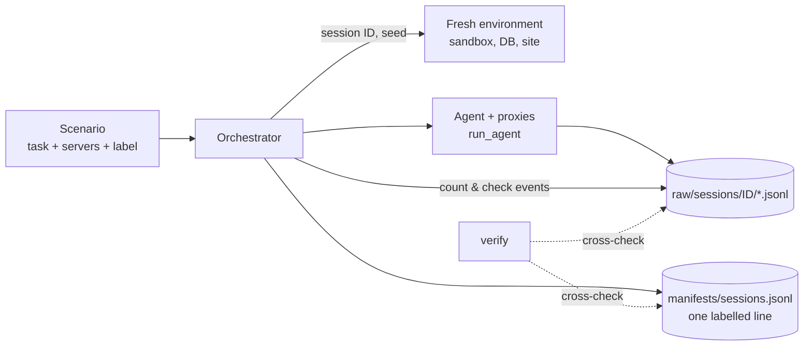

# The orchestrator (Phase 5)

## Simple version
Until now we ran single sessions by hand. The orchestrator turns them into
an **experiment**: it runs many sessions, and for each one writes a labelled
line to the **manifest**, the answer key the ML model learns from.



## Scenarios
A scenario = task + mounted servers + ground-truth label.

* `benign:<task>`: only the servers the task needs.
* `benign:<task>:all_servers`: all benign servers mounted, some unused.
  Real users mount many servers, and these sessions stop "an extra server is
  connected" from looking like an attack.
* `attack:<family>:<benign suffix>`: **twin** of a benign scenario with one
  server swapped for its attack twin (`twin_of` records the partner).

198 scenarios are registered since lab 0.9.0: 76 benign (2 per task), 44
`poisoned_tool`, 39 `shadowing` and 39 `sampling_injection` twins
(`python -m orchestrator.main list`). Attack twins are registered
automatically for every benign scenario that mounts the corresponding control
server; registering does not generate traffic. The poisoned
payload variant is `seed % 5`; the mock's obedience is set with
`--susceptibility` (default 0.35). Phase 9 now creates matched benign/attack
twins for each family trial (30 per family by default, 180 sessions total),
cycling deterministically through family probe tasks and their `all_servers`
twins. Each twin pair uses the same seed, and benign/attack server-count
distributions match. The per-session concurrency limit defaults to four; the
Docker memory limit is 2 GB. Earlier lab-0.7.0 data omitted `all_servers`
because some proxies were killed during shutdown before writing
`proxy/stop`. Lab 0.8.0 records `proxy/client_eof` first (see
[proxy.md](proxy.md#shutdown-and-the-2-second-kill-fixed-in-lab-080)), and
`verify` accepts a log that ends in a clean stop **or** a client_eof with no
unanswered requests; logs with neither are still rejected.

## The manifest
`<data_dir>/manifests/sessions.jsonl`, one line per session. Schema in
[dataset.md](dataset.md). Rules enforced on every write:

| label | attack_family | attack_attempted | attack_succeeded |
|---|---|---|---|
| `benign` | `null` | `false` | `false` |
| `attack` | one of `poisoned_tool`, `shadowing`, `sampling_injection` | `true` | `true` or `false` |

**Why labels live only in the manifest:** the logs must not contain the
answer. The proxy logs contain no label, and the ML pipeline joins logs with
labels by `session_id`.

**Failed sessions are recorded** (`status: "failed"`, with the root-cause
error) instead of disappearing. The dataset builder excludes them explicitly,
and the failure rate can be reported.

## Reproducibility
* Batch seeds are `base_seed, base_seed+1, …` in a fixed order, so the same
  command produces the same set of (scenario, seed) pairs.
* Same scenario and seed give **byte-identical wire traffic**: same methods,
  tools, arguments, errors and message sizes (`test_same_seed_reproduces_identical_wire_traffic`).
  Only session IDs and timestamps differ.
* This needs fixed resources: a seeded database, a copied sandbox, and a
  **fixed** test-site URL (`http://testweb:8080` in Docker, `127.0.0.1:18080`
  locally). Generate a dataset in **one** environment, because the two URLs
  differ in length.
* Every entry records `lab_version`, `seed`, `backend`, `dataset_tag` and
  timestamps.

## Verification (`verify`)
Checks that the manifest and logs agree:
* every OK session has one log file per mounted server;
* event counts match; every proxy stopped cleanly (exit 0, no unanswered requests);
* no more `tools/call` requests on the wire than the agent recorded;
* no duplicate session IDs; no log folders without a manifest entry ("orphans");
* an empty or missing manifest is reported as a problem, never as "consistent".

## Commands
```bash
python -m orchestrator.main list
python -m orchestrator.main run benign:db_order_status --seed 1
python -m orchestrator.main batch --scenarios benign --repeats 2 --parallel 4 --seed 1000
python -m orchestrator.main verify
python -m orchestrator.main --data-dir data/experiment_a batch --scenarios benign --tag exp_a
docker compose run --rm lab python -m scripts.generate_phase9 --output /lab/data/phase9_verified --seed 9000 --parallel 2
docker compose run --rm lab python -m scripts.generate_phase9 --output /lab/data/phase9_verified --verify-only
docker compose run --rm lab python -m scripts.generate_phase9 --output /lab/data/phase9_081_targeted --seed 9000 --parallel 4 --sessions-per-family 30
docker compose run --rm lab python -m scripts.generate_phase9 --output /lab/data/phase9_081_targeted --verify-only
docker compose run --rm lab python -m scripts.generate_phase9 --output /lab/data/phase9_081_targeted --seed 9000 --parallel 4 --sessions-per-family 30
```

## Memory and parallelism
Measured in the Docker lab: about **420 MB per concurrent six-server session**
(1 session: 450 MB peak, 2: 842 MB, 4: 1631 MB). The `lab` container's limit
is `LAB_MEM_LIMIT` (default `2g`), enough for `--parallel 4` with six-server
scenarios. With `LAB_MEM_LIMIT=1g`, use `--parallel 1` for six-server batches,
otherwise the orchestrator is OOM-killed mid-batch (exit code 137) and
in-flight sessions are left without manifest entries (`verify` reports them).

## Performance
Each server is a separate Python process (~1–3 s to start, servers
started one after another), so a 3-server session takes ~5 s. `--parallel 4`
runs 4 sessions at once: **31 sessions in ~32 s** on the development laptop,
both locally and in Docker.

## Log settling and end states (lab 0.9.0)
`run_session` waits until every proxy log of the session is final before it
counts events for the manifest (`settle_session_logs`): immediately when every
log has `proxy/stop`; otherwise after 0.3 s without growth once every log has
`proxy/stop` or `proxy/client_eof`; at most 5 s. The MCP SDK can return while a
proxy is still exiting (or abandon one after a failed kill), and a late final
event used to make `verify` report "N events on disk, manifest says M"
(observed once as an intermittent `test_mixed_batch_counts` failure). Each
manifest entry also records `log_end_states` per server (`stopped`,
`client_closed`, ...), and pytest keeps the temp folders of failed tests
(`tmp_path_retention_policy = "failed"`), so any recurrence is explainable.
