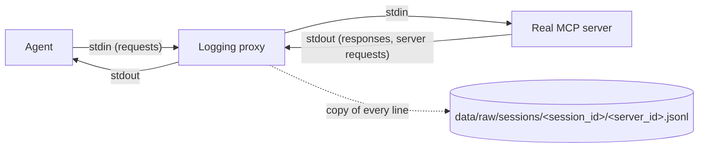

# The logging proxy (Phase 3)

## Simple version
The agent thinks it's talking to an MCP server, but it's really talking to the
proxy. The proxy starts the real server, passes every message through
**unchanged**, and writes a copy of each one to a log file. It's a wiretap
for MCP. The rest of the project (dataset, features, ML, detector) learns
only from these logs.



## Why a proxy, and not logging inside the agent or the server?
* **Independent witness.** The agent's own records could hide what a buggy or
  manipulated agent did. The proxy sees the actual bytes on the wire.
* **Works with any server**, including third-party servers we can't modify.
  An IDS has to work this way in practice.
* **Same position as a real deployment.** A production detector would sit
  exactly here, which makes the Phase 14 live detector a natural extension.

## Guarantees (each one is tested)
| Guarantee | How | Test |
|---|---|---|
| Bytes forwarded unchanged (CRLF, UTF-8, invalid lines) | raw line copy; parsing works on a copy | `test_proxy_forwards_bytes_unchanged` |
| Every message logged with the shared session ID | `MCP_SESSION_ID` env var | `test_agent_session_is_fully_logged` |
| Responses linked to their requests, in both directions | `(direction, id)` lookup table | `test_correlation_both_directions` |
| Proxy log agrees with the agent's own record | compared call by call | `test_agent_session_is_fully_logged` |
| Several servers in one session merge into one timeline | one file per server, merged by `mono_ns` (precise, cross-process) | `test_two_servers_one_session_merge`, `test_sort_events_prefers_precise_clock_and_falls_back` |
| A logging failure never breaks traffic | write errors disable logging only | `test_unwritable_log_dir_does_not_break_traffic` |

## Design decisions
* **Threads, not asyncio.** One thread per direction. On Windows, asyncio
  can't reliably read anonymous stdin pipes; threads behave the same on every OS.
* **Forward first, log second**, so logging adds no latency to the traffic.
* **One file per server per session.** Several proxy *processes* write at the
  same time, and on Windows appends to one shared file can interleave. The
  reader merges the files by `mono_ns` (see below), or by `ts_ns` for older logs.
* **Flush after every line**, so nothing is lost if the agent kills the
  proxy at shutdown.
* **Lifecycle events** (`proxy/start`, `proxy/client_eof`, `proxy/stop`)
  record the server command, exit code, message counts and unanswered
  requests. These are marked `direction: "proxy"` and must be excluded from
  wire-message features.

## Shutdown and the 2-second kill (fixed in lab 0.8.0)
The MCP SDK ends a stdio connection by closing the proxy's stdin, waiting
**2 s** (`PROCESS_TERMINATION_TIMEOUT`), then terminating the process tree
(POSIX: SIGTERM, then SIGKILL; Windows: immediate hard kill). With six
servers per session and parallel sessions, some proxy+server pairs needed
longer, so their `proxy/stop` was never written (`data/phase9`: 30 sessions,
40 of 41 losses on the first or second server connected).

| Event | When | Survives the kill? |
|---|---|---|
| `proxy/client_eof` | the client closed the connection (before the 2 s wait) | always written |
| `proxy/stop` (`exit_code`) | the server exited normally | only if within 2 s |
| `proxy/stop` (`terminated: "SIGTERM"`) | POSIX signal handler during the kill | POSIX only |

**Root cause: container memory.** Each concurrent six-server session needs
≈ 420 MB (12 Python processes). With the old 1 GB container limit,
`--parallel 4` hit the limit (measured: peak 1024 MB, 3 OOM kills, the
orchestrator itself killed). Near the limit everything slows down, so
proxies missed the 2 s window. The lab container now defaults to
`mem_limit: ${LAB_MEM_LIMIT:-2g}`. Measured with 2 GB: 22/22 six-server
sessions at `--parallel 4`, peak 1631 MB, 0 OOM kills, all 132 server logs
ended with a clean exit. The records below make logs robust even if a kill
still happens.

A server log is **complete** (`proxy.reader.log_end_state`) if it has a clean
`proxy/stop`, or a `proxy/client_eof` with no unanswered requests. In that
case every request was answered and the client had already disconnected, so
no traffic is missing. `verify` and the live detector use this rule.
Test: `tests/test_shutdown_and_capabilities.py`.

## Request/response race (fixed 2026-10-07)
Each direction runs in its own thread and forwards a line *before* logging it.
A fast server (the calculator answers in about 2 ms) could therefore answer a
request, and the other thread could log that response, before the request's
own thread had logged the request. The response was then logged without its
method or latency, the request stayed "unanswered", and `verify` reported the
server log as **unclean**. This happened once in a demo run; no saved dataset
contains it (0 unmatched responses across all datasets in `data/`).

Fix (`proxy/logger.py`): a response that finds no pending request waits up to
`EARLY_RESPONSE_WAIT_S` (0.1 s) for the other thread to register it. The wait
is in the logging step, after the response has been forwarded, so traffic is
not delayed; normally it lasts microseconds. A genuinely unmatched response is
still logged as before. Latency is still computed from the read timestamps.
Tests: `test_response_logged_before_its_request_is_still_matched` (fails
without the fix) and `test_unmatched_response_waits_only_briefly`; a 40-session
stress run of the fastest server produced 0 unmatched responses.

## Reading the logs
```bash
python -m proxy.reader                     # list sessions
python -m proxy.reader latest              # timeline of newest session
python -m proxy.reader latest --full       # timeline + full JSON bodies
```

Example timeline (real output, seed 1 of `fs_report_digest`):
```
   12.4ms filesystem  C -> S request      initialize        163B
 2099.1ms filesystem  C <- S response     initialize        359B  2086.8ms
 2100.1ms filesystem  C -> S request      tools/list         68B
 2102.6ms filesystem  C <- S response     tools/list       1662B     2.5ms  tools: list_directory, ...
 2313.4ms filesystem  C -> S request      tools/call        129B            read_file {"path": "reports/report.txt"}
 2316.4ms filesystem  C <- S response     tools/call        156B     3.0ms ERROR  File not found ...
```

## Caveats for feature engineering
* **`initialize` latency (~2 s) is Python start-up time** for the server
  process, not server behaviour. Don't use it as a feature, or normalise it
  per server.
* **Ordering across servers (fixed in lab 0.8.1, log schema v2).** Python's
  wall clock on Windows ticks only every ~15.6 ms, so messages from different
  proxies often shared a `ts_ns` (in `data/try6`, 382 of 1661 events) and
  ties were broken by server name, sometimes putting a response *after* the
  request it caused. The timestamp was also taken after forwarding. Now each
  line is stamped when it is **read** (before forwarding), and also with
  `mono_ns` = `time.perf_counter_ns()`, which is precise and comparable across
  processes (checked: 0 inversions in 40 causal handshakes between processes).
  Timelines are ordered by `mono_ns`; logs without it (≤ lab 0.8.0) keep the
  old deterministic `(ts_ns, server_id, seq)` order.
* Feature extraction on existing v1 data is unaffected (byte-identical
  `features.csv` for `data/try6`); new v2 sessions get the true cross-server order.
* Latency includes the proxy's own forwarding overhead (sub-millisecond).
